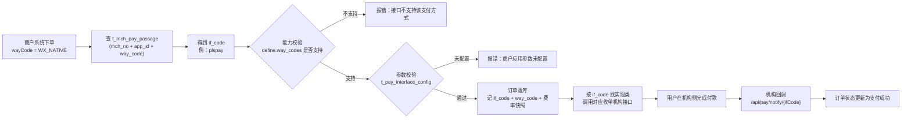

# 支付通道模型：支付方式、支付接口与收单机构

> 配套阅读：[database-relationships.md](./database-relationships.md)（讲表与表的关系）。本篇讲**业务概念**：为什么一笔支付里"用户怎么付"和"钱怎么结"可以是两件不同的事。

---

## 0. 一句话总览

```
用户在钱包侧的动作（way_code）  ×  收单机构的接入通道（if_code）  =  这笔支付的实际路径
        ↑ 用户在哪儿付                      ↑ 钱走谁的通道、跟谁结算
```

这两个维度**互相独立、可以自由组合**，组合结果由三张表共同决定：

`t_pay_way`（系统定义哪些付款动作）→ `t_pay_interface_define`（每条通道声明支持哪些动作）→ `t_mch_pay_passage`（这个商户应用实际走哪条通道）

---

## 1. 两个正交维度

| | 支付方式 `way_code` | 支付接口 `if_code` |
|---|---|---|
| 回答的问题 | 用户**怎么付** | 这笔钱**走谁的通道、跟谁结算** |
| 举例 | `WX_NATIVE` 微信扫码、`WX_BAR` 微信付款码、`WX_JSAPI` 公众号支付、`ALI_APP` 支付宝 APP | `wxpay` 微信官方、`alipay` 支付宝官方、`ysfpay` 云闪付/银联、`plspay` 计全付、`pppay` PayPal |
| 用户能否感知 | 能（在微信里扫、在支付宝里点） | 不能 |
| 谁来决定 | 商户下单时指定 | 平台按商户配置自动选出 |
| 决定什么 | 交互形态、报文里的产品类型 | 接口协议、密钥证书、费率、对账口径、结算主体 |
| 数据落在 | `t_pay_way` 字典表 | `t_pay_interface_define` |

**为什么容易混**：两个词都带"支付"，而且在配置界面里挨着放。记法一句话——
**`way` 是用户走的路，`if` 是钱走的路。**

---

## 2. 五个概念分层：谁管什么

| 概念 | 数据落点 | 回答的问题 | 缺了会怎样 |
|---|---|---|---|
| 支付方式字典 | `t_pay_way` | 系统认识哪些付款动作 | 配置界面上没有这个选项 |
| **支付接口定义** | `t_pay_interface_define` | 平台接了哪些上游通道、每条通道支持哪些支付方式与商户模式 | 下单报"无此支付通道接口" |
| 接口参数 | `t_pay_interface_config` | 某个主体（服务商/商户/应用）在某条通道上的密钥、证书、费率 | 下单报"商户应用参数未配置" |
| 商户通道路由 | `t_mch_pay_passage` | 这个商户应用的这种支付方式，**走哪条通道**、商户费率多少 | 下单报"商户应用不支持该支付方式" |
| 收单机构（外部实体） | **不在库里** | 谁收单、谁清算、谁给你结算 | — |

关于最后一行：**收单机构不是本项目的表**。"一家机构"在系统里由三样东西共同代表：`if_code`（身份字符串）+ `channel/{ifCode}/` 代码包（接口实现）+ `t_pay_interface_config.if_params`（对接参数）。机构的名称只出现在 `if_name` / `remark` 里，用于界面展示；结算周期、结算账户、对账文件都在机构侧，本项目不存。

---

## 3. 一次支付请求的完整链路



关键点：**通道是在"下单时"就定死的，不是用户付完钱才确定**。订单落库那一刻就写入了 `if_code`，后续回调、退款、查单、对账都靠它找回正确的实现类与结算通道。

对应代码位置：

| 步骤 | 代码 | 位置 |
|---|---|---|
| 路由查询 | `findMchPayPassage(mchNo, appId, wayCode)` | `jeepay-service/.../MchPayPassageService.java:106` |
| 能力 + 参数校验 | `checkMchWayCodeAndGetService()` | `jeepay-payment/.../ctrl/payorder/AbstractPayOrderController.java:287` |
| 订单快照 | `genPayOrder()` 写入 `if_code`/`way_code`/`mch_fee_rate` | 同文件 `:233` |
| 具体实现类 | `PaywayUtil.getRealPaywayService()` | `jeepay-payment/.../util/PaywayUtil.java:34` |
| 回调地址 | `getNotifyUrl()` = `paySiteUrl + /api/pay/notify/{ifCode}` | `jeepay-payment/.../channel/AbstractPaymentService.java:56` |

---

## 4. 组合的三个必要条件

"用户动作"和"结算路径"可以不同，但**不是随便组合**。可用组合 = 三者取交集：

| 条件 | 检查位置 | 不满足时的报错 |
|---|---|---|
| ① 通道声明支持该支付方式 | `t_pay_interface_define.way_codes`（JSON 数组）包含该 `way_code` | 接口不支持该支付方式 |
| ② 代码里有对应实现类 | `channel/{ifCode}/payway/{WayCode}.java` 存在 | 解析不到实现类，返回 null |
| ③ 商户配了这条路由 | `t_mch_pay_passage` 里有 `(app_id, if_code, way_code)` 记录 | 商户应用不支持该支付方式 |

条件 ① 的判定在商户配置界面和下单时都会用到，SQL 长这样（`jeepay-service/.../mapper/MchPayPassageMapper.xml:21`）：

```sql
select pid.if_code, pid.if_name, pic.if_params, pic.if_rate
from t_pay_interface_define pid
inner join t_pay_interface_config pic on pid.if_code = pic.if_code
where JSON_CONTAINS(pid.way_codes, JSON_OBJECT('wayCode', 'WX_NATIVE'))   -- 该通道支持这个支付方式
  and pid.state = 1                                                        -- 通道未被平台停用
  and pic.state = 1 and pic.info_type = 3 and pic.info_id = 'app_xxx'      -- 该应用参数已配置
  and pid.is_mch_mode = 1                                                  -- 支持普通商户模式
```

---

## 5. 同一个支付方式，三条不同的结算路径

以"用户出示微信付款码"（`WX_BAR`）为例，三种走法用户侧完全一样：

| | 走 `wxpay` 直连 | 走 `ysfpay` 银联 | 走 `plspay` 计全付 |
|---|---|---|---|
| 签约对手 | 微信支付 | 银联（收单机构） | 计全付（聚合服务商） |
| 谁给你结算 | 微信 | 银联 | 计全付 |
| 要配的参数 | 微信商户号、APIv3 密钥、证书 | 云闪付服务商 ID、私钥证书、机构编号 | 计全付商户号、appId、密钥 |
| 实现的代码类 | `channel/wxpay/payway/WxBar.java` | `channel/ysfpay/payway/WxBar.java` | `channel/plspay/payway/WxBar.java` |
| 费率来源 | `passage(wxpay, WX_BAR).rate` | `passage(ysfpay, WX_BAR).rate` | `passage(plspay, WX_BAR).rate` |

用户侧完全一样，钱的路却完全不同——这就是为什么商户需要在费率、稳定性、额度、对账便利性之间做取舍，也是 `t_mch_pay_passage` 这张路由表存在的意义。

反过来看"同一条通道受理别人家的支付方式"：`ysfpay` 的 `way_codes` 里包含 `WX_JSAPI`、`WX_BAR`、`ALI_JSAPI`、`ALI_BAR`——云闪付通道里居然有"微信 JSAPI"的实现类（`channel/ysfpay/payway/WxJsapi.java`，日志前缀写的是"【云闪付(wechatJs)jsapi支付】"），这就是**聚合收单**在代码层面的样子。

---

## 6. 三层开关：粒度不同，别改错

| 操作 | 影响范围 | 典型场景 |
|---|---|---|
| `t_pay_interface_define.state = 0` | **全平台**这条通道停用（所有商户、所有支付方式） | 通道方系统维护、整体下线 |
| `t_pay_interface_config.state = 0` | 只有**该主体**（服务商/商户/应用）在这条通道上的参数失效 | 某商户的证书过期 |
| `t_mch_pay_passage.state = 0` | 只有**该商户应用 + 该支付方式**的路由失效 | 这个商户不想用这条通道了 |

三层正好对应归属层级：**平台 → 主体 → 商户应用**。

---

## 7. 计费与结算：这套系统做了什么、没做什么

| 概念 | 数据落点 | 系统里的作用 |
|---|---|---|
| 商户费率 | `t_mch_pay_passage.rate` → 订单快照 `mch_fee_rate` / `mch_fee_amount` | **真正参与计算**：用于算分账基数（可分配金额 = 金额 − 商户手续费 − 已退款 − 已分账） |
| 上游成本费率 | `t_pay_interface_config.if_rate` | **只是记录**：代码里只用于增删改查和界面展示，没有任何计算引用它 |
| 清算 / 扣费 / 结算 | 无 | **不在本项目**：由收单机构按其账单执行 |
| 对账、差错处理、日切、结算批次 | 无 | **不在本项目**，属于二次开发范围（见 `payment-settlement-learning-plan.md`） |

结论：**这套系统负责"路由 + 订单状态 + 费率快照"，不负责"结算"。**

---

## 8. 两个容易被忽略的强绑定关系

### 8.1 渠道用户标识跟通道绑定，不能混用

获取用户 openid 的接口**必须传 `ifCode`**（`ChannelUserIdRQ.ifCode`），说明同一个微信用户，在微信直连通道下和银联通道下拿到的是**两个不同的标识**（服务商体系里是 `sub_openid`）。切换通道后，旧的渠道用户标识不能再用于新通道。

### 8.2 退款必须原路返回

退款单的 `if_code` 直接复制支付单的（`jeepay-payment/.../ctrl/refund/RefundOrderController.java:192`），退款实现也按原单的 `if_code` 去找（同文件 `:134`）。

**通道可以换，但一笔已支付的单只能从原通道退。**

---

## 9. 哪些接口要传 `ifCode`，哪些不用

| 接口 | 入参是否含 `ifCode` | 为什么 |
|---|---|---|
| 统一下单（用户付款） | **否**，只传 `wayCode` | 通道由平台按商户配置自动选出 |
| 转账（代付） | **是**（`TransferOrderRQ.ifCode`） | 没有"支付方式"维度，必须由商户指定走哪条代付通道 |
| 分账接收者绑定 | **是**（`DivisionReceiverBindRQ.ifCode`） | 接收账号要绑到某条具体通道上 |
| 获取渠道用户（openid） | **是**（`ChannelUserIdRQ.ifCode`） | 用户标识属于某个具体通道 |

---

## 10. 常见误解速查

| 误解 | 事实 |
|---|---|
| "服务商表就是存微信/支付宝渠道的" | 不是。服务商（`t_isv_info`）是**主体**（持有渠道资质的公司），渠道是 `t_pay_interface_define` |
| "收单机构也是一张表" | 不是。全库没有机构表，"一家机构"由 `if_code` + 代码包 + 参数共同代表 |
| "`if_code` 是商户下单时传的" | 支付不传，由路由表选出；只有转账/绑定/取用户标识才要传 |
| "一个 `if_code` 严格对应一家法人机构" | 不严格。它代表"一套接入实现 + 一条结算链路"，同一机构可以有多套接入（如微信 V2/V3） |
| "费率配好了系统会自动扣钱结算" | 不会。费率只做快照和分账基数，实际扣费结算在机构侧按渠道账单执行 |
| "支付方式决定走哪条通道" | 不完整。支付方式 + 商户应用 + 路由配置三者一起决定 |
| "接口定义表里没有的通道配一下参数就能用" | 不行。没定义就没实现类，下单直接报"无此支付通道接口" |

---

## 11. 自测题（复习时先自己答，再回上文核对）

1. `way_code` 和 `if_code` 各自回答什么问题？为什么说它们是正交的？
2. 用户在微信里扫码，钱有没有可能不是微信结算给他的？走的是哪条链路？
3. 商户配了通道却下单报"商户应用参数未配置"，问题出在哪张表？
4. `t_mch_pay_passage` 的唯一键为什么是 `(app_id, if_code, way_code)`，而不是 `(app_id, way_code)`？
5. 把 `t_pay_interface_define.state` 改成 0，会影响哪些商户？改成 `t_pay_interface_config.state = 0` 呢？
6. 同一个微信用户，为什么在两条不同通道下的 openid 不一样？
7. 一笔走 `ysfpay` 成功的支付，能不能走 `wxpay` 退款？为什么？
8. 系统里哪个费率真正参与金额计算？另一个费率有什么用？
9. 收银台模式下，为什么订单落库时 `if_code` 是空的？
10. `xxpay` 有完整代码实现却用不了，缺的是什么？

---

## 12. 代码与数据索引

| 主题 | 位置 |
|---|---|
| 支付方式字典初始化数据（24 条） | `docs/sql/init.sql` |
| 支付接口定义初始化数据（5 条，含 `way_codes`） | `docs/sql/init.sql` 第 738～778 行 |
| 统一下单入参（无 `ifCode`） | `jeepay-payment/.../rqrs/payorder/UnifiedOrderRQ.java` |
| 下单主流程（选路 + 校验 + 快照） | `jeepay-payment/.../ctrl/payorder/AbstractPayOrderController.java:167,174,233,287` |
| 通道可用清单 SQL | `jeepay-service/.../mapper/MchPayPassageMapper.xml:21` |
| 路由查询方法 | `jeepay-service/.../impl/MchPayPassageService.java:106` |
| (ifCode, wayCode) → 实现类 | `jeepay-payment/.../util/PaywayUtil.java:34` |
| 分账基数计算（用了商户手续费） | `jeepay-service/.../impl/PayOrderService.java:382` |
| 退款原路返回 | `jeepay-payment/.../ctrl/refund/RefundOrderController.java:134,192` |
