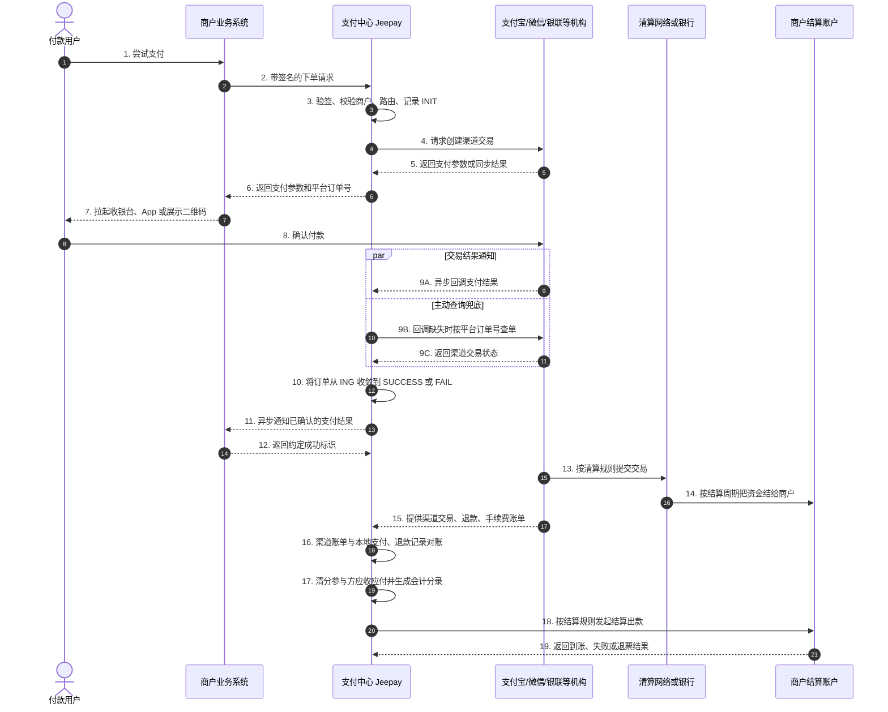
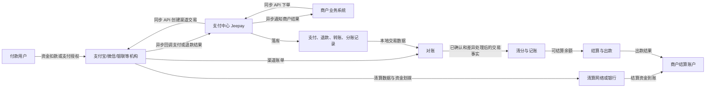
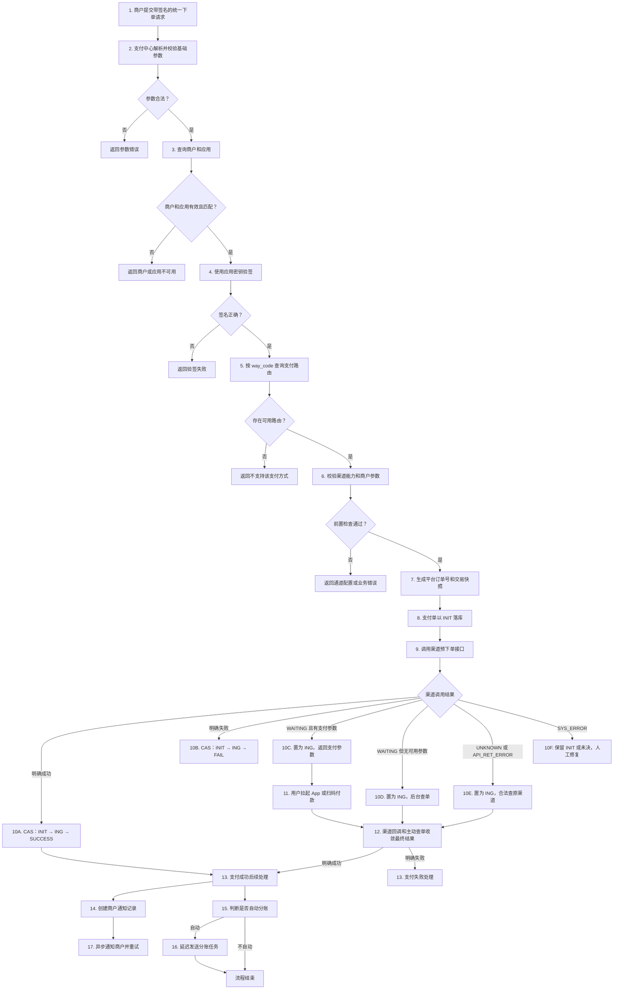
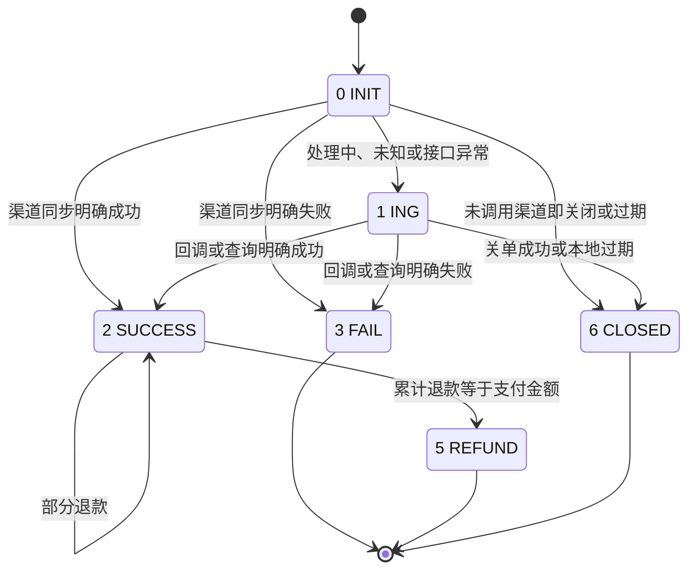
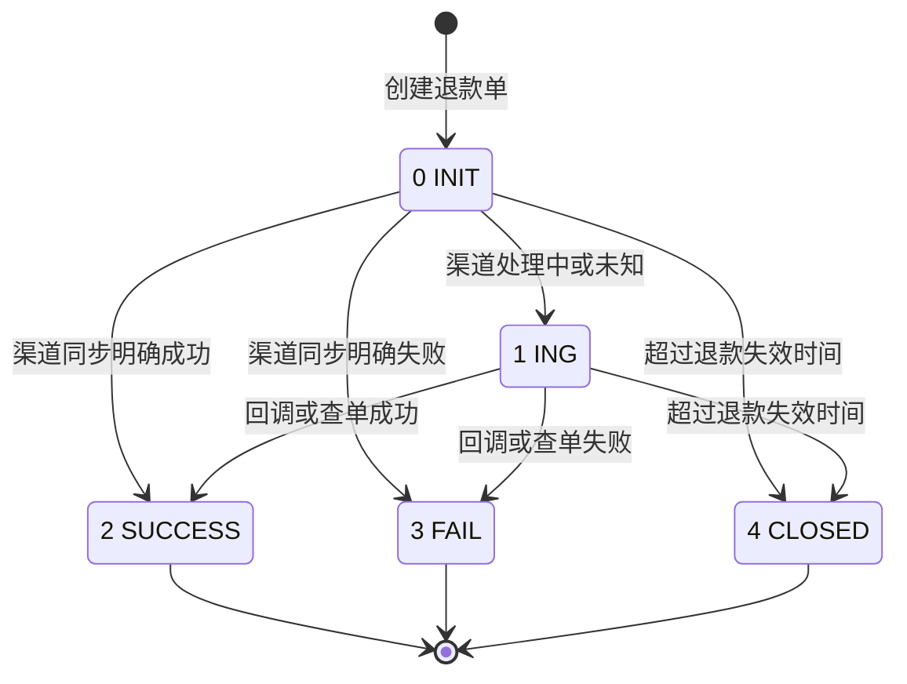
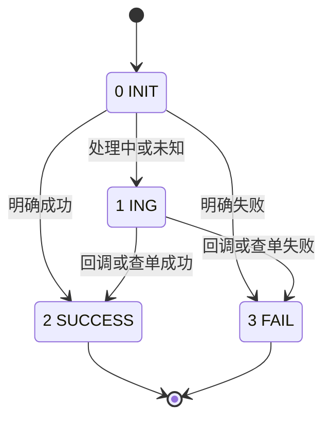
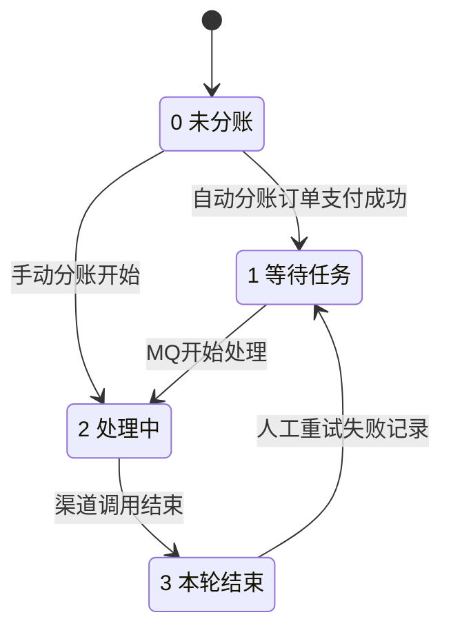
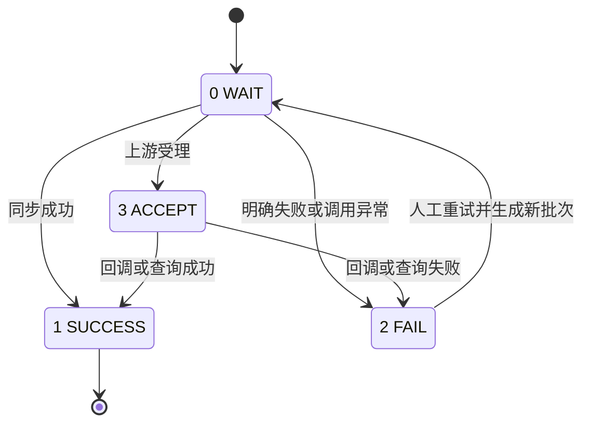

# Jeepay 支付结算工程师实战手册

> 适用目标：支付研发、交易研发、账务研发、清结算研发岗位。  
> 项目基线：当前工作区 Jeepay，Spring Boot 3.3.7、JDK 17、MySQL、Redis、MQ。  
> 文档定位：既用于系统学习、背诵和面试表达，也用于和多年支付、结算工程师讨论方案。  
> 重要边界：Jeepay 当前实现的是支付受理交易层，以及退款、转账、分账、通知和有限补偿；它没有完整实现复式记账、渠道对账、清分、商户账户、T+1 结算和结算出款。本手册会把这些缺失能力作为生产设计补全，而不会冒充项目现有功能。

---

## 目录

1. 先建立正确的支付结算全景
2. 必须准确区分的业务术语
3. 支付系统中的四类流
4. Jeepay 模块和代码职责
5. Jeepay 数据库模型
6. 商户、服务商、应用与权限体系
7. 支付产品、支付接口和路由
8. 下单前置校验与签名
9. 统一下单完整链路
10. 支付状态机与渠道结果收敛
11. 渠道回调
12. 主动查单和补单
13. 商户异步通知
14. 关单、撤单与过期
15. 退款
16. 转账或代付
17. 分账
18. 券码核销与支付的关系
19. 支付系统核心不变量
20. 幂等、并发和一致性
21. MQ、事务消息、Outbox 与最终一致性
22. 高并发设计
23. 渠道超时、重试、熔断和降级
24. 线上故障处理思路
25. 复式记账与账务系统
26. 清分
27. 结算
28. 出款和结算退票
29. 对账
30. 差错处理与调账
31. 日切、账期和账单
32. 风控、合规和资金安全
33. 可观测性、监控和告警
34. 容量、性能和数据库治理
35. 测试、故障演练和发布
36. Jeepay 当前实现风险清单
37. 典型线上问题演练
38. 与同事沟通的标准表达
39. 必背知识卡片
40. 自测题
41. 学习与验收路线
42. 代码阅读索引

---

# 1. 先建立正确的支付结算全景

支付结算系统不能只记“调用微信或支付宝接口”。需要同时理解交易、资金、消息和账务。--





用一句话概括支付中心：

> 支付中心负责把商户交易请求安全、可追溯地转换为渠道交易，然后把同步响应、异步回调和主动查询收敛为可信交易结果，并把结果稳定通知给商户。

用一句话概括结算系统：

> 结算系统根据已发生、已确认、已对账的交易和退款事实，计算各参与方应收应付，形成余额和结算单，并在合法、可控、幂等的前提下完成资金出款。

必须同时记住三个问题：

1. 这笔交易有没有成功？
2. 这笔钱最终归谁？
3. 这笔钱是否已经到账，并且账实一致？

---

# 2. 必须准确区分的业务术语

| 术语 | 准确含义 | 容易混淆的地方 |
|---|---|---|
| 支付 | 付款方向收款方转移资金 | 支付成功不等于结算完成 |
| 收单 | 收单机构受理商户交易并完成资金结算安排 | 技术接入不等于拥有收单资质 |
| 退款 | 将已支付资金全部或部分原路退回 | 不是独立转账 |
| 撤销 | 撤销尚未清算或尚未完成的交易或授权 | 和已支付后退款不同 |
| 关单 | 关闭未支付订单，阻止继续付款 | 不产生退款资金流 |
| 分账 | 将交易收入按规则分配给多个接收方 | 不等于最终结算 |
| 清分 | 计算各参与方应收、应付、手续费和净额 | 清分是算账，不一定动账 |
| 清算 | 参与者之间完成债权债务确认和资金划拨安排 | 有时与清分合并使用，讨论时要先确认口径 |
| 结算 | 按周期把可结算资金正式结给商户或参与方 | 结算完成通常还要核对出款结果 |
| 对账 | 两套独立记录逐笔或汇总比较 | 对账不等于自动改账 |
| 记账 | 把业务事实转换为会计分录 | 订单状态不能代替会计分录 |
| 出款 | 从平台或机构账户向商户、个人或企业付款 | 出款成功需要银行或渠道确认 |
| 日切 | 划分交易和账务所属业务日期 | 不是简单按自然日零点改状态 |
| 垫资 | 平台先用自有资金支付应付方 | 必须单独记账并评估资金风险 |
| 备付金 | 为退款、拒付或风险预留的资金 | 不能被当作普通可用余额 |
| 拒付 | 持卡人或机构对已入账交易提出争议 | 与普通退款流程不同 |
| 调账 | 用新的会计分录修正错误 | 不应直接篡改历史流水 |
| 差错 | 本地和渠道或账务之间的不一致 | 必须闭环处理，不能长期悬挂 |
| 滚动 reserve | 按交易金额或结算金额保留一定比例一段时间 | 常见于高风险业务 |
| D+0/D+1/T+1 | 结算到账时间规则 | 必须明确交易日、账期和到账时点 |

必须背下来的边界：

> 支付成功不等于商户可结算，可结算不等于已结算，已结算不等于已到账，到账后仍可能因退款、拒付或差错被追偿。

---

# 3. 支付系统中的四类流

## 3.1 业务流

```text
用户提交业务订单
→ 商户业务系统创建业务单
→ 调用支付中心创建支付单
→ 用户完成付款
→ 商户收到结果并履约
```

业务订单与支付订单必须分离：

- 业务订单是“买了什么”；
- 支付订单是“收了多少钱、怎么收的”；
- 退款订单是“退了多少、为什么退、退到哪里”；
- 结算单是“这期应结多少钱”；
- 出款单是“实际打了多少钱、银行是否成功”。

## 3.2 资金流

```text
付款用户银行账户
→ 发卡行
→ 清算网络
→ 支付机构或收单机构
→ 商户结算账户
```

支付中心的交易记录不代表资金已经到达平台账户。

## 3.3 交易流

```text
商户订单号
→ 平台支付单号
→ 渠道订单号
→ 渠道清算明细
→ 账务业务事件
→ 结算明细
→ 出款流水
```

这些编号和记录必须能互相映射。

## 3.4 消息流

- 商户请求支付中心：同步 HTTP；
- 支付中心请求渠道：同步 HTTP；
- 渠道通知支付中心：异步回调；
- 支付中心主动查渠道：同步查询；
- 支付中心通知商户：异步通知；
- 支付中心内部异步处理：MQ；
- 日终交换账单：文件或接口。

消息送达不等于业务成功。最终依据必须是经过验证和幂等处理的状态事实。

---

# 4. Jeepay 模块和代码职责

| 模块 | 职责 | 对支付工程师最重要的部分 |
|---|---|---|
| `jeepay-payment` | 开放支付网关 | 下单、查单、关单、回调、退款、转账、分账 |
| `jeepay-service` | 数据库服务和业务实现 | 订单状态更新、查询、通知、分账记录 |
| `jeepay-core` | 实体、常量、工具、公共模型 | 状态常量、签名、金额计算、渠道参数 |
| `jeepay-manager` | 运营平台后端 | 商户、服务商、通道、订单、人工通知重发 |
| `jeepay-merchant` | 商户平台后端 | 商户查单、配置、退款入口、分账管理 |
| `jeepay-components-mq` | 多 MQ 适配 | 延迟查单、通知重试、配置刷新 |
| `jeepay-components-oss` | 文件对象存储 | 证书、图片等文件管理 |
| `jeepay-z-codegen` | 代码生成 | 与交易主链路关系较小 |

当前支付渠道实现包括：

- 支付宝官方；
- 微信支付官方 V2/V3；
- 云闪付；
- PayPal；
- 计全付；
- `xxpay` 等接入实现。

统一渠道能力通过不同接口切开：

| 能力 | 作用 |
|---|---|
| 支付下单 | 创建渠道订单、返回支付参数 |
| 支付查询 | 按平台订单号查询渠道最终状态 |
| 支付关单 | 关闭渠道未支付订单 |
| 渠道回调 | 验签、解析、映射支付结果 |
| 退款 | 发起原路退款 |
| 退款查询 | 查询退款最终状态 |
| 退款回调 | 接收退款异步结果 |
| 转账 | 发起独立出款 |
| 转账查询和回调 | 确认出款结果 |
| 分账 | 绑定接收方、执行分账、查询、回调 |
| 渠道用户标识 | 获取 openid、user_id 等支付上下文 |

---

# 5. Jeepay 数据库模型

当前初始化脚本包含 23 张表。数据库没有物理外键，跨表一致性由业务代码维护。

## 5.1 系统和权限

| 表 | 关键作用 |
|---|---|
| `t_sys_user` | 运营和商户用户共用，按 `sys_type` 隔离 |
| `t_sys_user_auth` | 用户名、手机号等认证记录 |
| `t_sys_role` | 角色 |
| `t_sys_user_role_rela` | 用户角色关系 |
| `t_sys_entitlement` | 菜单和按钮权限 |
| `t_sys_role_ent_rela` | 角色权限关系 |
| `t_sys_config` | 平台访问地址等全局参数 |
| `t_sys_log` | 操作审计 |

## 5.2 商户和服务商

| 表 | 关键作用 |
|---|---|
| `t_isv_info` | 服务商主体 |
| `t_mch_info` | 普通商户或服务商下特约商户 |
| `t_mch_app` | 应用和 API 密钥 |

关系：

```text
服务商 1 ── N 商户 1 ── N 应用
```

## 5.3 支付方式和渠道配置

| 表 | 回答的问题 |
|---|---|
| `t_pay_way` | 用户怎样支付，例如扫码、JSAPI、App |
| `t_pay_interface_define` | 平台实现了哪套渠道协议以及支持哪些支付方式 |
| `t_pay_interface_config` | 某个服务商、商户或应用在某渠道上的密钥和参数 |
| `t_mch_pay_passage` | 某商户应用使用某支付方式时实际走哪条渠道、商户费率多少 |

## 5.4 交易数据

| 表 | 关键作用 |
|---|---|
| `t_pay_order` | 支付交易聚合根 |
| `t_refund_order` | 退款交易 |
| `t_transfer_order` | 独立转账或代付 |
| `t_mch_notify_record` | 向商户发送异步结果 |
| `t_order_snapshot` | 请求和响应报文快照预留表，当前代码未写入 |
| `t_mch_division_receiver_group` | 分账接收方组 |
| `t_mch_division_receiver` | 已绑定渠道的接收方 |
| `t_pay_order_division_record` | 每笔支付对每个接收方的分账记录 |

## 5.5 三个订单号

| 编号 | 来源 | 用途 |
|---|---|---|
| 商户订单号 | 商户系统 | 商户侧幂等和业务关联 |
| 平台订单号 | 支付中心 | 支付中心主键、渠道请求幂等键 |
| 渠道订单号 | 微信、支付宝等 | 渠道查单、对账、售后和客服 |

必须以“平台订单号”作为系统内部稳定关联键，而不是依赖可变或可能重复的商户单号。

## 5.6 当前索引状况

订单表的基础唯一键能防止重复商户单：

- `t_pay_order(mch_no, mch_order_no)`；
- `t_refund_order(mch_no, mch_refund_no)`；
- `t_transfer_order(mch_no, mch_order_no)`。

注意支付单唯一键不包含 `app_id`。因此同一个商户下不同应用也不能复用同一个 `mch_order_no`。退款和转账同理。

但还需要注意当前 SQL 的查询索引不充分：

- 退款查询常用 `pay_order_id + state`，但没有对应联合索引；
- 分账补偿常用 `state + created_at`、`batch_order_id + state`，但分账记录表除主键外没有业务索引；
- 通知扫描常用 `state + last_notify_time`，当前没有对应索引；
- 管理员按渠道订单号查询支付单时，没有 `channel_order_no` 索引。

小数据量时看不出问题，高并发和多年数据后会形成严重慢查询。

---

# 6. 商户、服务商、应用与权限体系

## 6.1 三种技术身份

1. 服务商 `isv_no`：代表服务商模式下的合作主体；
2. 商户 `mch_no`：收款、退款、分账和对账的业务主体；
3. 应用 `app_id`：实际 API 调用和签名主体，一个商户可有多个应用。

一个订单同时冗余：

```text
mch_no + isv_no + app_id
```

原因是历史订单必须能够还原归属，不能依赖商户或服务商当前配置。

## 6.2 普通商户模式

- 商户自己拥有支付宝、微信等商户参数；
- 支付中心只使用该应用级渠道参数；
- 渠道通常直接向该商户结算；
- Jeepay 记录的商户费率应当与合同口径一致。

## 6.3 服务商模式

- 服务商拥有上级渠道参数；
- 特约子商户有独立子商户号；
- 支付请求需要同时携带服务商身份和子商户身份；
- 支付宝可能有子商户授权 token；
- 微信可能有服务商商户号、子商户号、子 AppID。

典型参数组合：

```text
服务商配置：服务商商户号、应用、私钥、证书等
子商户配置：子商户号、子 AppID、授权 token
```

## 6.4 商户与应用状态

`t_mch_info.state` 和 `t_mch_app.state`：

- `0`：停用；
- `1`：正常。

下单时必须同时确认：

- 商户存在且启用；
- 应用存在且启用；
- 应用归属商户与请求商户号一致；
- 商户服务商关系有效。

## 6.5 认证和权限

- 运营平台和商户平台共用用户表，通过 `sys_type=MGR/MCH` 隔离；
- 用户通过角色关联权限；
- 权限支持菜单和按钮两个粒度；
- 登录成功后使用 JWT，并将 token 状态保存在 Redis；
- token 剩余有效期会随访问刷新；
- 高危后台操作应进入操作日志。

生产环境还需要：

- 管理端强制 MFA；
- 敏感操作双人复核；
- 密钥查看审批；
- IP 白名单和异常登录检测；
- 权限最小化；
- 日志不可篡改。

---

# 7. 支付产品、支付接口和路由

## 7.1 `way_code` 与 `if_code`

```text
way_code = 用户怎样完成支付
if_code  = 支付中心调用哪套渠道接口
```

例子：

| `way_code` | 含义 |
|---|---|
| `WX_JSAPI` | 微信内公众号 JSAPI |
| `WX_NATIVE` | 微信扫码 |
| `WX_BAR` | 微信付款码 |
| `WX_H5` | 微信 H5 |
| `ALI_APP` | 支付宝 App |
| `ALI_WAP` | 支付宝手机网站 |
| `ALI_BAR` | 支付宝付款码 |
| `YSF_JSAPI` | 云闪付 JSAPI |
| `QR_CASHIER` | Jeepay 聚合收银台 |
| `AUTO_BAR` | 根据付款码自动识别微信、支付宝或云闪付 |

## 7.2 路由逻辑

当前 Jeepay 的普通支付路由按：

```text
mch_no + app_id + way_code
```

查找启用的 `t_mch_pay_passage`，取得：

- `if_code`；
- 商户费率 `rate`；
- 风控配置 `risk_config`；
- 路由状态。

然后校验：

1. 渠道接口定义启用；
2. 渠道适配器支持该产品；
3. 普通商户或服务商子商户参数完整；
4. 渠道适配器前置检查通过。

## 7.3 当前路由的局限

- 同一应用和支付方式有多条可用通道时，没有明确的权重、成本优先级、成功率和故障转移算法；
- `risk_config` 字段存在，但当前主链路并没有实现完整风控引擎；
- 路由选择在业务调用过程中完成，没有独立的路由决策审计记录；
- 已经调用渠道并进入未知状态后，不能简单切换到另一个渠道重新下单。

生产级路由应至少考虑：

- 商户准入与产品开通；
- 渠道可用状态；
- 单笔和日累计限额；
- 成本费率；
- 渠道成功率；
- 当前并发和熔断状态；
- 交易类型和银行卡类型；
- 地区和通道能力；
- 资金结算周期；
- 风控标签。

但必须遵守：

> 只有渠道调用前可以选路；渠道调用结果未知时，应查原渠道，不能通过换路由规避未知状态。

---

# 8. 下单前置校验与签名

## 8.1 基础字段

统一下单至少包含：

| 字段 | 说明 |
|---|---|
| `mchNo` | 商户号 |
| `appId` | 应用 ID |
| `mchOrderNo` | 商户订单号 |
| `wayCode` | 支付方式 |
| `amount` | 金额，单位分 |
| `currency` | 币种 |
| `subject` | 商品标题 |
| `body` | 商品描述 |
| `clientIp` | 客户端 IP |
| `notifyUrl` | 异步通知地址 |
| `returnUrl` | 页面跳转地址 |
| `expiredTime` | 订单有效期 |
| `channelExtra` | 渠道特定参数 |
| `extParam` | 商户扩展参数 |
| `divisionMode` | 分账模式 |
| `sign` | 签名 |

基础校验包括：

- 金额至少 1 分；
- 分账模式只能是允许值；
- URL 只允许 HTTP 或 HTTPS；
- 关键字段不能为空。

## 8.2 当前签名逻辑

Jeepay 商户 API 当前签名流程可以概括为：

1. 将业务对象转换成键值集合；
2. 删除 `sign`；
3. 过滤空值；
4. 按字段名忽略大小写排序；
5. 拼成 `key=value&...`；
6. 末尾拼接应用密钥；
7. 计算 MD5 并转大写。

验签前必须先通过 `mchNo + appId` 找到应用密钥。

## 8.3 当前签名方案的生产风险

- MD5 只适合兼容老接口，不适合作为新系统首选；
- 如果签名中没有服务端强校验的时间戳和随机数，存在重放风险；
- 如果日志打印完整待签名串，会泄露敏感字段；
- 应用密钥在数据库和缓存中的保护等级必须足够高。

生产推荐：

- HMAC-SHA256 或 RSA2/ECDSA；
- 强制 `timestamp + nonce`；
- Redis 或本地短窗去重；
- 请求体规范化规则稳定且版本化；
- 支持密钥轮换和新旧密钥并行；
- 禁止在日志中记录私钥、完整签名原文和敏感身份信息。

## 8.4 URL 安全

商户可以传入 `notifyUrl`，支付中心会主动 POST 到该地址。当前代码主要限制协议，这不足以防 SSRF。

生产必须：

- 解析 URL 并拒绝内网、回环、链路本地和云元数据地址；
- 每次 DNS 解析后校验目标 IP，防止 DNS rebinding；
- 限制重定向；
- 使用独立出站代理和端口白名单；
- 限制响应体大小和超时；
- 对通知域名做商户归属校验。

---

# 9. 统一下单完整链路



## 9.1 预下单成功和支付成功的区别

- 预下单成功：渠道已经创建交易，并返回二维码、prepay_id、支付链接或 App 参数；
- 支付成功：用户授权并完成扣款，渠道确认资金交易成功；
- 支付成功通知：支付中心把结果发送给商户；
- 通知成功：商户返回约定的成功响应。

四者不能混为同一个状态。

## 9.2 为什么先落库再调用渠道

先落本地单是为了：

- 固定平台订单号；
- 让渠道请求具备幂等键；
- 外部超时后仍可按订单号查询；
- 回调能找到本地订单；
- 后续退款、通知、分账、对账都有主键。

本地数据库与外部渠道不能形成统一事务：

- 本地先成功、外部失败：订单可能停在 `INIT/ING`；
- 外部成功、本地更新失败：必须靠查询或对账恢复。

---

# 10. 支付状态机与渠道结果收敛

## 10.1 支付订单主状态

| 值 | 状态 | 含义 |
|---:|---|---|
| 0 | `INIT` | 本地订单已创建，尚无最终支付结果 |
| 1 | `ING` | 渠道处理中或结果未知 |
| 2 | `SUCCESS` | 支付成功 |
| 3 | `FAIL` | 支付失败 |
| 4 | `CANCEL` | 已撤销；当前代码未实际写入 |
| 5 | `REFUND` | 已累计全额退款 |
| 6 | `CLOSED` | 未支付订单关闭或过期 |



## 10.2 渠道响应语义

| 渠道语义 | 含义 | Jeepay 处理 |
|---|---|---|
| `CONFIRM_SUCCESS` | 渠道明确成功 | 订单最终成功 |
| `CONFIRM_FAIL` | 渠道明确失败 | 订单最终失败 |
| `WAITING` | 渠道已受理，结果尚未完成 | 订单进入 `ING` |
| `UNKNOWN` | 超时或无法确认结果 | 订单进入 `ING` |
| `API_RET_ERROR` | 渠道接口返回异常 | 订单进入 `ING` |
| `SYS_ERROR` | 支付中心自身异常 | 通常保留原状态 |

核心原则：

> 超时不是失败，无法确认也不是失败。

## 10.3 条件更新

Jeepay 使用带旧状态条件的更新：

```text
INIT → ING
条件：当前仍为 INIT

ING → SUCCESS/FAIL/CLOSED
条件：当前仍为 ING
```

这能保证回调和查询同时到达时只有一个请求完成终态迁移。

同步成功路径内部通常会先完成 `INIT → ING`，再完成 `ING → SUCCESS`，总效果仍然是不可逆的状态机推进。

## 10.4 支付单上的多组状态

### `refund_state`

- `0`：未发生实际退款；
- `1`：部分退款；
- `2`：全额退款。

### `division_mode`

- `0`：不分账；
- `1`：支付成功后自动分账；
- `2`：商户手动分账。

### `division_state`

- `0`：未发生分账；
- `1`：等待分账任务；
- `2`：分账处理中；
- `3`：本轮分账任务结束。

### `notify_state`

- `0`：尚未开始通知；
- `1`：已经开始通知。

`notify_state=1` 不代表商户已成功收到。

---

# 11. 渠道回调

## 11.1 渠道回调的职责

渠道回调用于把渠道确认的结果送入支付中心。它是重要事件，但不是唯一事实来源。

支付回调步骤：

1. 识别渠道和本地订单号；
2. 查询本地支付单；
3. 加载商户和渠道配置；
4. 验签；
5. 校验渠道商户号、应用号、订单号、金额、币种；
6. 只有当本地状态允许时才更新；
7. 成功时触发通知和分账；
8. 按渠道规范返回 ACK。

## 11.2 当前 Jeepay 的处理边界

支付异步回调主体只明确处理本地状态为 `ING` 的订单：

- `ING + 渠道成功` → `SUCCESS`；
- `ING + 渠道失败` → `FAIL`；
- 已经是终态时，不应重复迁移。

这说明 `ING` 是“等待渠道最终确认”，不是“回调目标状态”。

## 11.3 回调风险

### 重复回调

必须幂等：

- 状态条件更新；
- 唯一通知记录；
- 唯一账务业务事件；
- 唯一结算归属。

### 乱序回调

先失败、后成功，或先成功、后处理中，不能按到达顺序覆盖最终事实。需要查单或按状态优先级处理。

### 早到回调

回调可能早于支付中心完成同步响应后的状态更新。生产状态机应支持正确排队、重查或受控处理 `INIT → SUCCESS/FAIL`。

### 晚到回调

本地订单已经关闭，渠道后到成功，属于晚到支付。应进入差错队列，主动查单后选择补单、退款或人工处理。

### 金额或商户不匹配

即使验签正确，也必须核对：

- 平台订单号；
- 渠道订单号；
- 支付宝应用 ID / 微信商户号；
- 金额；
- 币种；
- 交易状态。

### ACK 与业务提交

只有本地状态更新获得可信结果后才返回渠道成功 ACK。若本地暂时异常，应按渠道协议返回失败让其重试。

---

# 12. 主动查单和补单

## 12.1 两种查单

1. 商户调用 Jeepay 查询接口：读取 Jeepay 本地订单；
2. Jeepay 内部补单：调用渠道查询真实状态。

商户查询本地订单不等于渠道实况，因此要在结果中明确状态和最后更新时间。

## 12.2 MQ 延迟查单

当前实现：

- 只有渠道适配器返回“需要查询”标记时才发送延迟消息；
- 首次延迟 5 秒；
- 只有订单仍为 `ING` 才查渠道；
- 查询返回空、无状态或 `WAITING` 时才再次延迟；
- 查询返回 `UNKNOWN` 时，当前 MQ 链不会继续发送，后续主要依赖分钟级扫描；
- 单条 MQ 链最多查询 6 次。

这个机制针对“渠道明确要求查询”或“首次结果未知”的订单。

## 12.3 定时扫描

当前支付补单任务：

- 每分钟执行；
- 扫描创建超过 10 分钟的 `ING` 订单；
- 每页 100 条；
- 调用渠道查询；
- 成功后更新并执行成功后续动作；
- 失败后更新失败；
- 未知则保留到下轮。

它是 MQ 链之外的兜底。

## 12.4 当前空档

- `SYS_ERROR` 可能使订单留在 `INIT`，但常规补单只扫描 `ING`；
- MQ 投递失败后，短期重试链可能中断；
- 定时任务没有分布式锁，多实例会重复扫描；
- 没有按渠道、商户分片的限流和退避；
- 长时间未知订单缺少强制升级到人工差错队列的策略。

生产方案应保存：

```text
channel_create_state
last_query_time
next_query_time
query_count
last_channel_code
last_channel_message
manual_review_state
```

## 12.5 当前补偿机制总表

| 对象 | 触发方式 | 当前规则 | 风险 |
|---|---|---|---|
| 支付订单 | 延迟 MQ | 首次 5 秒，单链最多 6 次 | 消息丢失或进程崩溃可中断 |
| 支付订单 | 定时扫描 | 每分钟扫描创建超过 10 分钟的 `ING` | 多实例重复扫描、无分片限流 |
| 支付订单 | 过期任务 | 每分钟关闭过期 `INIT/ING` | 未先确认渠道关闭，存在晚到成功 |
| 退款订单 | 回调 | 渠道退款通知 | 回调可能重复、乱序或丢失 |
| 退款订单 | 定时扫描 | 每分钟扫描全部 `ING` 退款 | 大量退款时查询压力大，无显式次数上限 |
| 退款订单 | 过期任务 | 过期 `INIT/ING` 改为关闭 | 渠道可能稍后成功 |
| 转账订单 | 回调 | 渠道转账通知 | 未知状态必须继续查 |
| 转账订单 | 定时扫描 | 每分钟扫描最近一天内创建的 `ING` 转账 | 超过一天不再自动扫描，也无转账关闭任务 |
| 商户通知 | 延迟 MQ | 失败后阶梯延迟，默认最多 6 次 | 无独立扫描“长期通知中”记录 |
| 自动分账 | 延迟 MQ | 支付成功 80 秒后触发 | 进程异常时父状态可能卡在处理中 |
| 分账受理 | 定时扫描 | 创建超过 5 分钟仍为已受理 | 按批次查询，依赖业务索引 |

---

# 13. 商户异步通知

## 13.1 通知目标

通知商户：

- 支付成功；
- 退款成功或失败；
- 转账成功或失败。

当前支付失败路径没有直接发送支付失败异步通知，商户应依赖同步响应或主动查询。

## 13.2 通知记录

`t_mch_notify_record` 使用：

```text
order_id + order_type
```

保证同一订单同一类型只有一条通知记录。

`order_type`：

- `1`：支付；
- `2`：退款；
- `3`：转账。

## 13.3 通知内容

通知中包含订单状态、金额、渠道订单号、时间戳和签名。商户处理顺序应为：

1. 验签；
2. 校验商户和应用；
3. 校验订单号和金额；
4. 查询本地业务订单；
5. 事务内幂等处理；
6. 返回约定成功标识。

## 13.4 重试

默认最多 6 次：

- 首次立即；
- 失败后 30 秒；
- 再失败 60 秒；
- 再失败 90 秒；
- 再失败 120 秒；
- 再失败 150 秒；
- 第 6 次仍失败则记录失败。

商户必须返回纯 `SUCCESS`，当前比较不忽略首尾空白。

## 13.5 通知状态

- `1 通知中`；
- `2 通知成功`；
- `3 通知失败`；
- 人工重发可把失败改回通知中，并增加最大次数。

## 13.6 通知可靠性的关键原则

- 通知是至少一次，不是恰好一次；
- 通知失败不能回滚支付成功；
- 通知重试必须使用同一条通知记录；
- 商户必须幂等；
- 通知超时、DNS、TLS、HTTP 状态码都要记录；
- 长时间通知积压必须告警；
- 不能把商户返回 HTTP 200 自动等同于业务成功。

---

# 14. 关单、撤单与过期

## 14.1 商户主动关单

当前只允许关闭 `INIT` 或 `ING` 订单。

### `INIT`

尚未与渠道建立确定关系，可直接条件更新为 `CLOSED`。

### `ING`

必须调用渠道关单。只有渠道明确关闭成功，本地才改为 `CLOSED`。

## 14.2 自动过期

支付单默认两小时失效。当前定时任务每分钟把到过期时间且仍为 `INIT/ING` 的订单直接改为 `CLOSED`。

风险：

- 本地关闭不代表渠道关闭；
- 用户可能已经付款但回调尚未到；
- 过期后到达的成功回调可能被现状状态机忽略；
- 可能产生本地无成功记录但渠道已扣款。

生产必须：

- 过期前调用渠道关闭；
- 关闭后主动查单；
- 接受晚到成功并进入差错处理；
- 日终对账识别本地关闭、渠道成功。

## 14.3 关单、撤单、退款

| 场景 | 是否发生资金退回 |
|---|---|
| 关单 | 通常没有，因为尚未成功支付 |
| 撤销授权或撤销未清算交易 | 释放原交易资金或授权 |
| 退款 | 已成功支付后退回 |

---

# 15. 退款

## 15.1 退款是什么

退款是将已经成功的支付资金按全部或部分金额退回原付款方。

退款必须：

- 关联原支付单；
- 使用原支付渠道；
- 有独立退款单号；
- 有独立状态；
- 有独立通知记录；
- 累计金额不能超过原支付金额。

## 15.2 Jeepay 退款前置条件

当前代码在发起退款前检查：

1. 商户和应用验签通过；
2. 原支付单存在且属于当前商户；
3. 原支付状态为 `SUCCESS`；
4. 原订单没有全额退款；
5. 本次退款金额不超过剩余可退款金额；
6. 原支付单不存在处理中退款；
7. 历史成功退款金额加本次金额不超过支付金额；
8. 商户退款订单号未重复；
9. 原渠道支持退款；
10. 渠道配置可用。

退款单唯一键：

```text
mch_no + mch_refund_no
```

## 15.3 退款状态

| 值 | 状态 | 含义 |
|---:|---|---|
| 0 | `INIT` | 退款单已创建 |
| 1 | `ING` | 渠道处理中或结果未知 |
| 2 | `SUCCESS` | 退款成功 |
| 3 | `FAIL` | 退款失败 |
| 4 | `CLOSED` | 退款任务关闭或过期 |



## 15.4 退款成功如何回写支付单

退款成功时需要在同一数据库事务中：

1. 退款单 `ING → SUCCESS`；
2. `refund_times + 1`；
3. `refund_amount + 本次退款金额`；
4. 判断是否为部分还是全额退款；
5. 全额退款时：
   - `refund_state = 2`；
   - 支付主状态 `SUCCESS → REFUND`；
6. 部分退款时：
   - `refund_state = 1`；
   - 支付主状态仍为 `SUCCESS`。

支付单回写带有强约束：

```text
当前支付状态必须为 SUCCESS
已退款金额 + 本次退款金额 <= 原支付金额
退款汇总状态只能从未退款或部分退款继续推进
```

这能阻止多个成功事件把累计退款金额写成负数或超过支付金额。

## 15.5 为什么退款必须有独立订单

- 一笔支付可以多次部分退款；
- 每笔退款有自己的渠道单号；
- 每笔退款可能独立超时；
- 每笔退款需要单独通知；
- 财务需要准确知道每次退款金额和原因；
- 直接修改支付单金额会破坏历史账务。

## 15.6 退款查询与补单

退款进入 `ING` 后：

- 渠道退款回调可以推进结果；
- 定时任务每分钟扫描退款中订单；
- 调用渠道退款查询；
- 明确成功或失败后更新并通知商户。

当前退款补单没有显式次数上限。

## 15.7 退款并发窗口

Jeepay 通过“是否已有 `ING` 退款单”和“累计金额”做双重校验，但两个退款请求在申请阶段仍可能并发穿过检查。

数据库最终在支付单回写时能阻止累计金额超过原金额，但这发生在渠道退款成功之后。也就是说：

- 数据库不会让退款累计值超限；
- 但渠道退款资金可能已经发生。

生产级方案：

- 支付单行锁；
- 退款额度冻结表；
- 唯一退款占用记录；
- 数据库事务内预占可退额度；
- 余额不足时在调用渠道前失败；
- 渠道成功后把冻结额度转为已退款。

## 15.8 退款过期风险

退款单默认两小时失效，定时任务会把 `INIT/ING` 退款单改成 `CLOSED`。

如果渠道退款实际上仍在处理或稍后成功，就会出现：

- 本地退款关闭；
- 渠道退款成功；
- 资金已经退回用户；
- 本地累计退款金额没有增加。

生产必须：

- 过期前查询渠道；
- 渠道仍处理中时不能武断关闭；
- 关闭必须记录渠道确认信息；
- 晚到退款成功进入差错处理；
- 日终用渠道退款账单校正。

## 15.9 退款失败后的再次退款

失败退款单保留审计，不能修改原单为新的成功交易。

若仍有可退余额，应：

- 新建退款单；
- 使用新的商户退款单号；
- 关联同一支付单；
- 保留上次失败原因；
- 受累计成功退款金额约束。

---

# 16. 转账或代付

## 16.1 转账的定位

转账是支付中心主动向指定账户付款。

常见目标：

- 微信零钱；
- 支付宝账户；
- 银行卡；
- 商户结算账户。

它和退款不同：

| 对比项 | 退款 | 转账 |
|---|---|---|
| 是否关联原支付 | 必须 | 不必须 |
| 资金路径 | 原路退回 | 指定目标账户 |
| 金额约束 | 不超过原支付可退余额 | 受商户余额、风控和限额约束 |
| 渠道要求 | 必须支持原单退款 | 需要代付或转账能力 |

## 16.2 Jeepay 转账链路

1. 商户提交签名请求；
2. 校验商户和应用；
3. 校验商户订单号唯一；
4. 校验通知地址；
5. 商户明确传入 `if_code`；
6. 校验应用开通该渠道；
7. 校验渠道支持对应入账方式；
8. 生成转账单并以 `INIT` 落库；
9. 渠道适配器前置检查；
10. 发起转账；
11. 根据响应更新状态；
12. 回调或查单确认；
13. 通知商户。

## 16.3 转账状态

| 值 | 状态 | 含义 |
|---:|---|---|
| 0 | `INIT` | 转账单生成 |
| 1 | `ING` | 转账中或未知 |
| 2 | `SUCCESS` | 出款成功 |
| 3 | `FAIL` | 出款失败 |
| 4 | `CLOSED` | 已定义，当前未实际写入 |



## 16.4 转账补单

定时任务每分钟扫描创建时间在最近一天内且状态为 `ING` 的转账单，并调用渠道查询。

- 成功：更新并通知；
- 失败：更新并通知；
- 未知：继续保留。

超过一天仍为 `ING` 的转账单不在该任务的查询范围内，需要单独告警和人工处理。

## 16.5 转账最大的线上风险

调用渠道出款超时，渠道实际可能已经成功。如果系统判定失败并让商户重新发起，就产生重复出款。

必须遵守：

- 同一转账业务只使用一个稳定平台单号；
- 超时后先查原渠道；
- 不因 HTTP 超时再次生成第二笔转账；
- 出款业务和审批、余额冻结、银行退票一起设计；
- 对 `ING` 超过阈值设置强告警和人工核对。

## 16.6 Jeepay 当前缺失

- 没有商户余额扣减；
- 没有资金冻结；
- 没有代付手续费计算；
- 没有出款账户账务流水；
- 没有收款人四要素校验的统一风控；
- 没有批量代付和批次状态；
- 没有银行退票后的资金回冲。

因此 Jeepay 的转账是渠道调用能力，不等于完整代付资金系统。

---

# 17. 分账

## 17.1 分账解决什么问题

分账用于把一笔交易收入按约定分配给多个参与方，例如：

- 商户；
- 平台服务费；
- 服务商；
- 门店；
- 供应商；
- 推广人员。

分账只确定交易收入的分配关系，不自动完成最终结算。

## 17.2 分账数据模型

```text
接收方组
  └── 接收方账号
        ├── 商户 / 应用
        ├── 渠道
        ├── 账号类型和账号
        ├── 渠道关系类型
        └── 分账比例
```

分账记录保存账号和比例快照，因为接收方配置未来可能变化。

## 17.3 自动分账

1. 下单时 `division_mode=1`；
2. 创建渠道订单时可能需要标记冻结分账资金；
3. 支付成功后父订单 `division_state` 从 `0 → 1`；
4. 延迟 80 秒发送分账 MQ；
5. 消息消费时 `1 → 2`；
6. 查询自动分账组的有效接收方；
7. 计算金额并创建记录；
8. 调渠道分账；
9. 记录变为成功、失败或已受理；
10. 父订单 `2 → 3`。

## 17.4 手动分账

前置条件：

- 支付状态 `SUCCESS`；
- `division_mode=2`；
- `division_state=0`；
- 接收方或组属于该商户；
- 接收方在当前应用和渠道下启用。

## 17.5 可分配金额

```text
可分配金额
= 支付金额
- 商户手续费
- 已成功退款金额
- 已成功分账金额
```

结果小于等于 0 时取 0。

这说明退款和分账存在资金竞争。生产系统必须明确：

- 先分账还是先等待退款窗口；
- 已分账后的退款由谁承担；
- 分账接收方是否支持反向退回；
- 是否要求平台垫资；
- 负余额如何追偿。

## 17.6 分账父状态



父状态 `3` 不代表全部成功。

## 17.7 单条记录状态

| 值 | 状态 | 含义 |
|---:|---|---|
| 0 | `WAIT` | 待分账 |
| 1 | `SUCCESS` | 明确成功 |
| 2 | `FAIL` | 明确失败 |
| 3 | `ACCEPT` | 上游已受理 |



## 17.8 分账补偿

- 已受理记录超过 5 分钟后可由任务查询；
- 回调也可以逐条返回结果；
- 失败记录可由商户人工重发；
- 重发时父订单回到等待任务；
- 失败记录回到待分账；
- 生成新的系统分账批次号。

## 17.9 当前分账实现的注意点

- 父任务异常后可能停在处理中；
- 分账接口调用异常不等于渠道一定没有分账；
- 失败记录重发前必须先查询原批次；
- 分账成功后发生退款，需要额外追偿流程；
- 分账记录表缺少按 `pay_order_id/state/batch_order_id` 的索引；
- 当前没有通过商户通知表统一发送分账结果。

---

# 18. 券码核销与支付的关系

“核销”至少有两种业务含义。

## 18.1 券码、权益或消费凭证核销

```text
用户购买
→ 支付成功
→ 发放券码或权益
→ 到店或线上使用
→ 核销
→ 业务订单履约完成
```

核销应属于商户业务系统，支付中心只提供：

- 支付成功事件；
- 平台支付单号；
- 商户业务单号映射；
- 退款和撤销事件。

不应把核销状态塞进支付订单主状态。

## 18.2 资金核销

如果同事说“到账核销”，通常指：

- 银行或渠道资金已到账；
- 将到账记录与应收、交易或结算记录匹配；
- 形成已核销或未核销结果。

这属于对账或结算差错处理，不是用户付款动作。

和支付、结算同事交流时，先确认“核销的是券、订单履约，还是银行到账资金”。

---

# 19. 支付系统核心不变量与金额规则

## 19.1 金额和费率模型

Jeepay 当前金额字段是整数分：

```text
10000 = 100.00 元
```

费率是小数：

```text
0.006 = 0.6%
```

手续费：

```text
手续费金额 = round(支付金额 × 商户费率)
```

当前实现按四舍五入保留到分。

实付金额：

```text
用户实付 = 订单金额
商户应得 = 订单金额 - 商户手续费 - 退款 - 分账
```

手续费是交易价格的一部分，通常不额外加到用户支付金额上，除非产品明确约定“用户承担手续费”。

一个订单一落地，应保存：

- 支付金额；
- 商户费率快照；
- 商户手续费金额快照；
- 渠道接口；
- 支付方式；
- 分账模式；
- 订单失效时间。

配置表当前区分两类费率：

- `t_mch_pay_passage.rate`：Jeepay 向商户计算用的商户费率；
- `t_pay_interface_config.if_rate`：支付接口配置中的接口费率。

当前生成支付单时使用的是 `mch_pay_passage.rate`。不能把 `if_rate` 说成一定会自动参与支付单手续费计算。

## 19.2 计费产品必须明确的问题

- 费率含税还是不含税；
- 费率是否包含渠道成本；
- 固定手续费；
- 最低手续费；
- 封顶手续费；
- 阶梯费率；
- 按支付方式区分；
- 按卡类型区分；
- 按地区和币种区分；
- 退款是否退手续费；
- 分账金额是否参与手续费；
- 计费基数是支付金额还是净额；
- 舍入规则；
- 费用由商户、用户还是平台承担。

## 19.3 舍入风险

以下两种算法结果可能不同：

```text
先逐笔四舍五入再汇总
先汇总再四舍五入
```

清分、结算和对账必须统一约定。

多接收方分账时还要处理：

- 分账比例总和超过 100%；
- 不足 100% 的剩余金额归属；
- 多个接收方舍入后的尾差；
- 最后一笔是否需要吞尾；
- 退款后如何反向拆回；
- 平台是否承担尾差。

## 19.4 金额防御

- 数据库使用 `BIGINT` 保存分；
- Java 使用 `Long`，最终结果避免 `double`；
- 大额计算检查溢出；
- 金额必须大于零，退款和调账方向使用显式业务类型；
- 币种必须随金额一起传递；
- 不同币种不能直接相加；
- 汇率必须保存来源、时间和快照；
- 外币金额的最小单位不能默认都是 100。

## 19.5 核心不变量

这些不变量应背到形成条件反射。

1. 金额只用最小货币单位整数，不用浮点数。
2. 商户订单号在商户范围内唯一。
3. 平台订单号是外部调用和内部关联的稳定幂等键。
4. 先形成本地交易记录，再调用外部渠道。
5. 请求超时不等于业务失败。
6. 回调验签、金额、商户、订单号都必须校验。
7. 交易终态不可随意回退。
8. 重复消息必须幂等。
9. 支付成功、通知成功、账务入账、结算完成是四个不同事实。
10. 退款必须原路、独立、可查询。
11. 出款超时不能盲目重发。
12. 分账完成不等于结算完成。
13. 对账发现差异不能直接自动覆盖业务订单。
14. 会计分录不可删除或篡改，只能冲正。
15. 任何资金动作都要有唯一业务键和审计链。
16. 渠道账单和银行回单是外部事实，不以本地状态猜测。
17. 日切必须有明确业务时区和边界。
18. 线上人工操作必须最小权限、双人复核、全程留痕。

---

# 20. 幂等、并发和一致性

## 20.1 幂等的定义

同一业务请求执行一次和执行多次，最终结果一致。

幂等不等于“重复请求返回相同 HTTP 状态”，真正要求是：

- 不重复扣款；
- 不重复退款；
- 不重复分账；
- 不重复出款；
- 不重复记账；
- 不重复结算。

## 20.2 常见幂等键

| 业务 | 建议唯一键 |
|---|---|
| 支付 | 商户号 + 商户订单号 |
| 退款 | 商户号 + 商户退款单号 |
| 转账 | 商户号 + 商户转账单号 |
| 渠道回调 | 渠道 + 渠道通知唯一标识 |
| 商户通知 | 订单号 + 订单类型 |
| 账务事件 | 渠道 + 渠道事件号或内部业务事件号 |
| 结算明细 | 支付或退款事件 + 有效结算批次 |
| 出款 | 结算单号 + 收款账户 + 币种 |

## 20.3 幂等实现层次

### 数据库唯一约束

最后防线，必须存在。不能只依赖 Redis `SETNX`。

### 状态条件更新

例如：

```text
UPDATE pay_order
SET state = SUCCESS
WHERE pay_order_id = ?
AND state = ING
```

返回更新行数用于判断是否抢到状态迁移权。

### 行锁

适合退款额度预占、余额扣减等强一致场景。

### 乐观锁

适合状态机的低冲突迁移，但冲突时必须重新读取并判断业务事实。

### 幂等表

记录请求摘要、处理状态和结果，适合对外 API 重试。

## 20.4 不能只依赖的机制

- 只依赖前端按钮防重；
- 只依赖 Redis 锁；
- 只依赖 MQ 不重复投递；
- 只依赖先查后改；
- 只依赖日志搜索。

这些机制都可能失效。数据库唯一约束和不可变流水是最终防线。

## 20.5 并发退款

错误方案：

```text
查询订单可退余额
调用退款
成功后增加退款金额
```

两个请求可能同时通过查询。

生产方案：

1. 开启数据库事务；
2. 锁定支付单或退款额度账户；
3. 校验可退余额；
4. 原子预占退款金额；
5. 提交本地退款单；
6. 调渠道；
7. 渠道明确失败时释放预占；
8. 渠道成功后转为已退款；
9. 渠道未知时保持冻结并查询；
10. 对账确认。

## 20.6 并发通知

同一通知消息可能被并发消费。需要：

- 行锁或版本号；
- 原子领取；
- 通知状态 CAS；
- 发送幂等 token；
- 记录尝试次数；
- 避免多个消费者同时绕过次数上限。

## 20.7 热点账户

大量交易同时更新同一个商户余额会形成行锁热点。

常见方案：

- 按账户分片记账；
- 按日或业务维度拆分余额桶；
- 先写明细再异步汇总；
- 结算时合并；
- 不把报表汇总字段作为唯一事实来源。

## 20.8 商户 API 的幂等语义

生产支付 API 建议明确：

| 场景 | 推荐行为 |
|---|---|
| 相同幂等键、相同请求摘要、业务仍处理中 | 返回原平台订单号和当前状态 |
| 相同幂等键、相同请求摘要、业务已完成 | 返回原结果 |
| 相同幂等键、不同请求摘要 | 返回幂等冲突 |
| 新幂等键、相同订单号 | 按商户订单号返回已有订单或冲突 |
| 全新请求 | 创建新订单 |

当前 Jeepay 主要通过唯一键和先查重阻止重复，对重复请求通常返回“商户订单已存在”，不是完整的幂等重放响应。生产接入时应保存请求摘要和首次结果。

对高并发重试场景，还建议客户端传：

```text
idempotencyKey
timestamp
nonce
requestVersion
```

服务端需要保存幂等结果到合理的业务窗口，例如覆盖用户和商户最长的自动重试周期。

## 20.9 对外 API 的返回语义

支付 API 不应只有“成功”和“失败”两个业务结果。

| 对外结果 | 含义 |
|---|---|
| 参数错误 | 请求不合法，未创建交易 |
| 鉴权失败 | 商户、应用或签名无效 |
| 幂等冲突 | 同一业务键的数据与原请求不同 |
| 明确拒绝 | 业务或渠道明确拒绝，没有成功资金 |
| 已受理待支付 | 渠道订单已创建，已返回支付参数 |
| 结果未知 | 可能已经创建渠道交易，调用方不得换单号重试 |
| 成功 | 渠道明确成功 |
| 失败 | 渠道明确失败 |

HTTP 200 不代表支付成功，HTTP 5xx 也不自动代表资金没有变动。客户端必须读取业务码、平台订单号和订单状态。

---

# 21. MQ、事务消息、Outbox 与最终一致性

## 21.1 Jeepay 当前 MQ 场景

- 支付状态未知后的延迟查单；
- 支付成功后的商户通知；
- 自动分账；
- 配置缓存刷新；
- 登录鉴权缓存清理。

## 21.2 MQ 不能解决什么问题

- 不能自动保证业务幂等；
- 不能把外部渠道和本地数据库放进一个事务；
- 不能保证消费者恰好执行一次；
- 不能替代对账；
- 不能修复错误业务规则。

当前多个 MQ Receiver 使用异步线程执行。无论具体 MQ 客户端如何实现 ACK，都不能把“监听方法已被调用”当成“业务事务已完成”。生产配置必须确认消息确认发生在业务成功之后，或者使用数据库任务表和可恢复 Outbox。

## 21.3 事务内更新状态并发送消息的风险

可能发生：

```text
数据库提交成功
→ 服务崩溃
→ MQ 消息没有发出
→ 商户永远收不到通知或分账不触发
```

也可能发生：

```text
MQ先发
→ 数据库失败
→ 消费者处理一个不存在的状态
```

## 21.4 Outbox 模式

推荐流程：

1. 在业务数据库同一事务中：
   - 更新支付状态；
   - 写 outbox 事件；
2. 独立发布器扫描未发送 outbox；
3. 发布 MQ；
4. 记录发布时间；
5. 消费方按事件 ID 幂等；
6. 定期扫描长时间未发布事件。

好处是业务状态和待发消息至少有一个持久化来源。

## 21.5 最终一致性

接受短暂不一致，但必须限定：

- 不一致最长持续时间；
- 哪些数据允许暂时不一致；
- 哪个事实是权威来源；
- 如何自动补偿；
- 何时升级人工。

资金主账不应以“最终一致”为借口长期不准确。

---

# 22. 高并发设计

## 22.1 交易入口

- 网关层限流；
- 按商户、应用、接口、IP 多维度限流；
- 防重放；
- 请求体大小限制；
- 慢请求超时；
- 密钥校验和渠道调用的资源隔离；
- 大商户使用独立租户配额。

## 22.2 数据库

- 订单按创建时间或商户分片；
- 历史订单归档；
- 避免无条件深分页；
- 为状态扫描建立专用索引；
- 使用覆盖索引提供商户查询；
- 金额更新使用原子 SQL；
- 避免长事务中调用外部渠道；
- 将渠道调用放在事务边界之外或使用明确的预占模式。

## 22.3 缓存

Jeepay 用本地内存缓存商户应用和服务商配置，配置刷新依赖 MQ；关闭缓存开关后直接查数据库。

注意：

- 多实例必须收到缓存失效消息；
- 缓存没有有效 TTL 时，MQ 丢失可能长期脏读；
- 商户停用、密钥轮换必须快速生效；
- 不应将完整密钥不必要地复制到所有实例；
- 缓存击穿要做 single-flight。

## 22.4 渠道调用隔离

- 每个渠道独立连接池和超时；
- 每个渠道独立线程池或 bulkhead；
- 不同渠道故障不能拖垮全部支付；
- 对渠道错误率设置熔断；
- 对查询流量与下单流量隔离；
- 对同一渠道限制并发。

## 22.5 后台任务

- 使用分布式任务调度或 leader election；
- 按时间窗口和状态建立索引；
- 分片扫描；
- 小批量提交；
- 失败隔离到单条；
- 处理幂等；
- 记录水位和进度；
- 避免所有实例同时全表扫描。

Jeepay 当前多个 `@Scheduled` 任务在单实例内简单执行，代码中未发现统一的分布式锁和分片机制。多实例部署时应补上。

## 22.6 线程池

当前 MQ 组件配置了一个共享执行器：

- 核心线程 20；
- 最大线程 300；
- 队列 10；
- 拒绝策略为调用者执行。

商户通知的 HTTP 超时为 20 秒，和其他 MQ 业务共用线程池时可能造成阻塞、排队和故障扩散。

生产建议：

- 不同业务独立线程池；
- 通知发送与支付查单隔离；
- 队列容量、超时和拒绝策略压测后确定；
- 绝不能无限扩容线程；
- 记录排队时间、活跃线程和拒绝次数。

---

# 23. 渠道超时、重试、熔断和降级

## 23.1 超时的层次

一次 HTTP 调用至少有：

- DNS 超时；
- TCP 建连超时；
- TLS 握手超时；
- 连接池获取超时；
- 写请求超时；
- 读响应超时；
- 总业务 deadline。

只设置一个笼统超时不够，必须确认实际请求是否已经到达渠道。

## 23.2 重试分类

| 操作 | 是否可重试 | 前提 |
|---|---|---|
| 支付下单 | 谨慎 | 渠道支持同一订单号幂等 |
| 支付查询 | 可以 | 查询无副作用 |
| 关单 | 可以 | 同一订单号重复关闭幂等 |
| 退款 | 谨慎 | 同一退款单号幂等 |
| 退款查询 | 可以 | 查询无副作用 |
| 转账 | 非常谨慎 | 同一出款单号强幂等 |
| 转账查询 | 可以 | 查询无副作用 |
| 商户通知 | 可以 | 商户业务处理幂等 |
| 分账 | 谨慎 | 同一分账批次或明细幂等 |

永远不要：

- 支付超时后生成新平台单号再下同一次业务；
- 退款超时后新建退款单号再次退款；
- 转账超时后换新单号再次出款；
- 对不可重试的 HTTP 4xx 盲目重试。

## 23.3 退避策略

推荐：

- 指数退避；
- 加随机抖动；
- 设置最大次数；
- 设置总等待时间；
- 对永久错误立即停止；
- 记录下一次执行时间。

例如：

```text
1s → 2s → 4s → 8s → 16s
每轮加入 0～30% 随机抖动
```

对账和日终任务不能无限追求低延迟，应优先稳定和可重跑。

## 23.4 熔断

熔断器状态：

- 关闭：正常调用；
- 打开：短时间直接拒绝；
- 半开：允许少量探测。

触发指标：

- 超时率；
- 5xx 比例；
- 连续失败次数；
- 响应时间；
- 渠道明确维护公告。

熔断后：

- 下单可以选择其他未故障通道，但只能在外呼前；
- 已进入未知状态的订单只能查原渠道；
- 查询任务要保留，不能因熔断丢失；
- 商户侧应收到可识别的“暂时不可用”，不能伪装成支付失败。

## 23.5 降级

可降级：

- 非核心报表；
- 实时通知改为延迟发送；
- 管理端实时统计改为缓存；
- 自动分账延后。

不可降级：

- 交易金额校验；
- 回调验签；
- 重复支付防护；
- 余额/额度硬约束；
- 账务唯一性；
- 出款幂等。

## 23.6 外部渠道故障时的沟通口径

> 当前渠道下单成功率快速下降，系统只对确认失败且尚未创建渠道订单的请求进行受控切换。已经返回未知或处理中的订单，继续按原平台订单号查询原渠道，不会重新生成订单，以避免重复扣款。

---

# 24. 线上故障处理思路

处理线上支付问题必须按以下顺序：

1. 先判断是否仍在发生资金损失；
2. 确认影响交易范围和金额；
3. 冻结高风险人工操作；
4. 保留日志、报文和当前数据库状态；
5. 以渠道查询和渠道账单恢复事实；
6. 通过幂等补单修复状态；
7. 用会计分录调账；
8. 复盘规则和监控缺口。

不要一上来直接改数据库状态。

## 24.1 支付长期停在 `ING`

排查顺序：

1. 查询支付单、渠道订单号、创建时间、最后更新时间；
2. 查询渠道真实状态；
3. 检查 MQ 是否积压；
4. 检查补单任务是否运行；
5. 检查是否有回调拒绝日志；
6. 检查金额、商户号或订单号是否不匹配；
7. 明确成功后走 CAS 和后续动作；
8. 仍未知则升级人工差错。

绝不能：

- 直接改成成功；
- 直接改成失败后重新下单；
- 忽略渠道已有付款。

## 24.2 渠道成功但本地失败

1. 暂缓自动重试和用户退款；
2. 用渠道订单号查询；
3. 保存渠道凭证；
4. 若本地订单存在，执行合法状态修复；
5. 若本地订单缺失，进入无主支付处理；
6. 判断补业务单、原路退款还是人工核销；
7. 通知业务方和客服；
8. 日终再次对账。

## 24.3 支付成功但商户未收到通知

1. 查看 `t_mch_notify_record`；
2. 查看通知次数、响应、最近时间；
3. 检查商户 URL、DNS、TLS、防火墙；
4. 检查 MQ 和线程池；
5. 商户返回成功但业务未处理时，让商户按支付单号补处理；
6. 人工重发必须在商户幂等前提下进行；
7. 通知失败不能回滚支付。

## 24.4 重复回调

1. 确认是否同一渠道订单；
2. 确认本地已经成功；
3. 检查是否重复通知；
4. 检查是否重复分账；
5. 检查是否重复记账；
6. 按渠道规范返回 ACK；
7. 没有重复副作用就无需改订单。

## 24.5 回调金额不一致

1. 不更新订单；
2. 对比本地下单金额、渠道请求快照和回调查询；
3. 再次主动查单；
4. 若渠道确实金额不同，进入订单异常；
5. 冻结发货和结算；
6. 根据差异选择退款、补单或人工处理；
7. 记录安全事件。

## 24.6 晚到成功

1. 本地可能已经 `CLOSED`；
2. 不能当成普通重复回调忽略；
3. 查询渠道确认；
4. 判断用户是否已经获得服务；
5. 未履约可以补单；
6. 不应履约或重复时可以退款；
7. 生成差错记录并纳入日终对账。

## 24.7 退款成功但本地仍为退款中

1. 查询渠道退款状态；
2. 检查退款回调是否到达；
3. 检查本地事务是否失败；
4. 用退款单号执行条件更新；
5. 在事务内回写支付单累计退款；
6. 对通知做幂等补发；
7. 核对账务是否需要补记。

## 24.8 退款失败但用户收到钱

这是高风险场景：

1. 立即查询渠道退款；
2. 冻结重复退款；
3. 以渠道和银行回单为准；
4. 修复退款单与支付单累计金额；
5. 补记退款账务；
6. 检查本地失败原因是否误判；
7. 纳入差错和人工复核。

## 24.9 转账超时

1. 保持 `ING`；
2. 立即按平台转账单号查询；
3. 查询银行或渠道回单；
4. 成功则更新并通知；
5. 失败则确认失败并释放冻结；
6. 未知时禁止重复出款；
7. 超过阈值升级人工。

## 24.10 重复出款

1. 暂停该收款账户所有自动出款；
2. 核对两笔流水是否同业务；
3. 查询渠道和银行；
4. 记录平台应收并追偿；
5. 检查幂等键和重试逻辑；
6. 增加账户级互斥和唯一约束；
7. 双人复核后续处理。

## 24.11 商户通知大量失败

1. 判断单个商户还是全局；
2. 检查 DNS、TLS、网络、代理；
3. 检查商户响应是否符合约定；
4. 检查线程池和 MQ 积压；
5. 暂停高成本重试或做限流；
6. 保持通知记录；
7. 恢复后分批补发。

## 24.12 MQ 积压

1. 查看积压量和增长速度；
2. 区分支付查询、通知、分账等消息；
3. 判断消费者阻塞还是生产突增；
4. 扩容前先确认下游渠道和数据库容量；
5. 对非核心消息降级；
6. 避免丢弃资金相关消息；
7. 恢复后按幂等规则补消费。

## 24.13 配置缓存不一致

症状：

- 新密钥不生效；
- 商户已经停用仍可下单；
- 通道参数更新后部分实例失败；
- 不同机器表现不同。

处理：

1. 核对数据库配置；
2. 检查配置刷新 MQ；
3. 确认所有实例是否收到；
4. 临时滚动重启或清缓存；
5. 补缓存 TTL 和版本号；
6. 记录密钥变更审计。

## 24.14 系统时间异常

会影响：

- 订单过期；
- 签名时间窗口；
- 渠道证书；
- 日切；
- 延迟队列；
- 对账账期。

必须使用统一 NTP，监控时钟漂移，交易日期由服务端可信时间决定。

---

# 25. 复式记账与账务系统

## 25.1 为什么订单状态不能当账

支付订单只表达交易状态，无法完整表达：

- 渠道应收；
- 商户应付；
- 手续费收入；
- 退款负债；
- 平台垫资；
- 已结算金额；
- 未结算金额；
- 差错挂账。

账务系统要对每一笔价值变化形成借贷相等、不可随意修改的会计分录。

## 25.2 基本恒等式

```text
资产 = 负债 + 所有者权益
```

每笔分录：

```text
借方合计 = 贷方合计
```

## 25.3 推荐的账户类型

| 账户 | 类型 | 含义 |
|---|---|---|
| 渠道清算应收 | 资产 | 渠道应付给平台但尚未到账 |
| 银行存管资金 | 资产 | 平台银行账户实际资金 |
| 商户待结算款 | 负债 | 平台欠商户的已确认交易款 |
| 商户可结算款 | 负债 | 满足结算条件、待出款 |
| 商户冻结款 | 负债 | 风控、退款或争议冻结 |
| 手续费收入 | 收入 | 平台向商户收取的费用 |
| 渠道成本 | 成本 | 支付机构收取的费用 |
| 退款应付 | 负债 | 已决定退款但尚未完成 |
| 结算应付 | 负债 | 已生成结算单但尚未出款 |
| 商户欠款 | 资产 | 结算后退款或差错形成应收 |
| 差错挂账 | 资产或负债 | 尚未确认归属的差异 |

实际科目和列报要由财务制度确定，技术系统不应自行臆造监管口径。

## 25.4 支付成功的简化分录

假设平台是主要责任人，用户支付 100 元，商户费 0.6 元：

```text
借：渠道清算应收      100.00
    贷：商户待结算款    99.40
    贷：手续费收入       0.60
```

如果平台只是代理、不控制资金且只收取服务费，财务列报可能只记录服务费，不能把 100 元全部确认收入。必须按真实合同和资金控制权判断“总额法还是净额法”。

## 25.5 渠道结算到账

渠道实际结算 99.62 元到平台银行账户：

```text
借：银行存款          99.62
借：渠道成本           0.38
    贷：渠道清算应收   100.00
```

平台再向商户结算 99.40 元：

```text
借：商户待结算款      99.40
    贷：银行存款       99.40
```

平台毛利 0.22 元由收入减成本体现。

这些是概念示例。真实记账方式取决于：

- 资金是否直接进入平台账户；
- 平台是否为收单主体；
- 分账是在渠道侧完成还是平台侧完成；
- 手续费由谁承担；
- 平台是否控制商品或服务；
- 企业会计政策。

## 25.6 退款记账

退款必须根据结算状态分别处理。

### 结算前退款

通常需要冲减商户待结算款，并冲减渠道应收；手续费是否退回按合同处理。

### 结算后退款

平台可能：

- 从商户余额扣回；
- 形成商户欠款；
- 冻结后续结算；
- 从下一期抵扣；
- 用风险准备金承担。

不能直接修改原来支付成功的分录，应新增退款分录。

## 25.7 账务事件

推荐账务事件表：

```text
event_id
event_type
source_system
source_order_id
channel_event_id
business_date
currency
amount
status
idempotency_key
created_at
```

事件示例：

- `PAYMENT_SUCCEEDED`
- `PAYMENT_FEE_CHARGED`
- `REFUND_SUCCEEDED`
- `DIVISION_SUCCEEDED`
- `CHANNEL_SETTLED`
- `SETTLEMENT_CREATED`
- `PAYOUT_SUCCEEDED`
- `PAYOUT_RETURNED`

同一事件只能生成一次账务分录，依靠唯一幂等键保证。

## 25.8 账务表的不可变性

- 分录创建后不能直接改金额；
- 错误通过反向分录冲正；
- 每次冲正关联原分录；
- 余额由明细汇总或可靠物化视图得到；
- 任何人工调账必须有审批、原因和附件；
- 每日做借贷平衡检查。

## 25.9 日终账务检查

必须验证：

1. 当日借方总额等于贷方总额；
2. 每个账户期初 + 发生额 = 期末；
3. 支付成功金额与账务入账金额一致；
4. 退款成功金额与账务冲减一致；
5. 渠道应收和渠道结算一致；
6. 商户应付和结算明细一致；
7. 差错挂账有 owner 和处理期限；
8. 业务日和时间戳可审计。

## 25.10 推荐的账务数据模型

以下不是 Jeepay 现有表，而是生产化扩展建议。

### 账户表

```text
account_id
subject_code
owner_type
owner_id
currency
account_kind
state
created_at
```

`account_kind` 可表达：

- 商户待结算；
- 商户可结算；
- 商户冻结；
- 商户欠款；
- 渠道应收；
- 银行资金；
- 手续费收入；
- 渠道成本；
- 差错挂账。

### 账务事件表

```text
event_id
event_type
source_type
source_id
source_version
business_date
event_time
amount
currency
payload_hash
status
created_at
```

唯一键：

```text
event_type + source_type + source_id + source_version
```

账务事件用于防止重复成功回调或重复消费生成多次分录。

### 凭证表

```text
journal_id
event_id
business_date
currency
status
posted_at
```

一个账务事件通常只生成一张有效凭证。

### 分录表

```text
entry_id
journal_id
line_no
account_id
direction
amount
currency
memo
```

`direction` 为借或贷。

约束：

- 同一凭证每行 `line_no` 唯一；
- 借贷总额相等；
- 分录创建后不可修改；
- 冲正通过新凭证完成。

### 余额表

```text
account_id
business_date
pending_amount
available_amount
frozen_amount
settled_amount
version
```

余额表是加速查询的物化结果，分录是事实来源。

必须定期从分录重算余额并与物化余额对账。

### 冻结表

```text
hold_id
account_id
business_type
business_id
amount
currency
state
expire_at
created_at
released_at
```

用于：

- 在途退款；
- 风控冻结；
- 待确认出款；
- 争议冻结。

冻结必须有唯一业务键，防止重复冻结。

---

# 26. 清分

## 26.1 清分解决什么问题

清分根据交易、退款、手续费、分账和调账事实，计算各主体应收应付。

典型参与方：

- 商户；
- 服务商；
- 平台；
- 渠道或支付机构；
- 分账接收方；
- 风险准备金。

## 26.2 清分输入

- 已确认支付成功交易；
- 已确认退款；
- 商户费率和手续费；
- 渠道成本；
- 分账结果；
- 调整和差错处理；
- 准备金额度；
- 合同和优惠规则；
- 账期和起止时间。

## 26.3 清分步骤

1. 锁定清分截止时间；
2. 拉取符合条件的支付和退款；
3. 校验账务事件完整性；
4. 计算每一方金额；
5. 生成清分明细；
6. 校验汇总和借贷平衡；
7. 冻结清分结果；
8. 生成结算候选。

## 26.4 清分结果

```text
商户收入 = 支付金额 - 商户手续费 - 退款 - 分账 - 冻结/预留 + 调账
渠道成本 = 支付金额 × 渠道合同费率或渠道账单实际费用
平台毛利 = 商户手续费收入 - 渠道成本
```

真实公式必须按合同和业务模式调整。

## 26.5 清分批次

建议字段：

```text
clearing_batch_id
business_date
cutoff_time
status
source_count
source_amount
result_count
result_amount
checksum
created_at
completed_at
```

必须支持：

- 唯一批次；
- 幂等重跑；
- 输入版本；
- 结果可重现；
- 批次前后金额校验；
- 人工冻结。

## 26.6 清分和记账的边界

- 清分负责“算出各方的钱”；
- 记账负责“记录债权债务和收入成本”；
- 结算负责“按规则释放资金”；
- 出款负责“真正打钱”；
- 对账负责“验证这些过程和外部事实”。

---

# 27. 结算

## 27.1 结算前的资格

一笔交易通常要同时满足：

- 支付成功；
- 已完成渠道对账；
- 未全额退款；
- 不在风险冻结期；
- 已达到账期；
- 未被其他结算单占用；
- 商户状态正常；
- 金额达到最小结算额；
- 结算账户有效。

## 27.2 结算周期

常见：

- `T+0`：当日交易满足条件当日结算；
- `T+1`：下一工作日；
- `D+1`：次日；
- `D+N`：固定自然日延迟；
- 周结、月结、人工结算。

必须明确：

- 交易日如何归属；
- 截止时间；
- 节假日顺延规则；
- 时区；
- 退款和拒付什么时候扣；
- 跨日交易属于哪一期。

## 27.3 结算金额

简化公式：

```text
本期应结
= 本期支付成功
- 商户手续费
- 本期退款
- 分账扣减
- 风险预留
- 上期负数结转
+ 上期补结或调账
```

不要只看支付单汇总，应以账务余额和清分结果为准。

## 27.4 结算单状态

推荐状态：

```text
CREATED
→ CALCULATED
→ REVIEWING
→ APPROVED
→ PAYOUT_PENDING
→ PAYING
→ SUCCESS
```

异常状态：

```text
CALC_FAILED
REJECTED
PAYOUT_FAILED
PAYOUT_UNKNOWN
PARTIALLY_RETURNED
CLOSED
```

业务定义可按公司口径调整，但必须有：

- 状态迁移条件；
- 操作人员；
- 审批记录；
- 幂等键；
- 金额校验；
- 冲正方式。

## 27.5 结算明细唯一归属

同一支付或退款事实不能同时进入两个有效结算批次。

建议：

```text
UNIQUE(accounting_event_id, settlement_cycle)
```

更严谨的是单独创建 `settlement_item`，对每个账务事件建立唯一有效占用。

## 27.6 结算幂等

重复执行计算任务，应得到相同结果或识别输入已变化：

- 固定输入水位；
- 批次唯一；
- 明细唯一；
- 计算过程可重放；
- 已审批批次禁止重新生成；
- 重新计算必须产生新版本。

## 27.7 负余额

场景：

- 结算后退款；
- 拒付；
- 渠道费用补扣；
- 差错追偿。

处理方式：

- 下期抵扣；
- 商户余额扣减；
- 形成商户欠款；
- 冻结后续结算；
- 人工催收；
- 风险准备金承担。

不能简单让结算金额变成负数直接出款。

## 27.8 结算与分账

分账后平台应结算的剩余资金可能减少。

如果分账已在渠道侧完成：

- 渠道可能直接把各接收方资金分走；
- 平台只结算自身剩余部分；
- 分账回执和渠道账单必须核对。

如果平台侧先记应付再统一出款：

- 需要额外的接收方账户和出款流程；
- 不能把分账记录当作已经到账。

## 27.9 推荐的结算数据模型

### 结算批次

```text
settlement_batch_id
business_date
cycle_code
currency
status
source_watermark
item_count
payable_amount
created_at
approved_at
completed_at
```

唯一键：

```text
cycle_code + business_date + currency
```

### 结算单

```text
settlement_order_id
settlement_batch_id
account_id
merchant_no
payable_amount
deduction_amount
reserve_amount
net_amount
status
version
```

### 结算明细

```text
settlement_item_id
settlement_order_id
accounting_event_id
event_type
amount
```

健康约束：

```text
UNIQUE(accounting_event_id, active_settlement_scope)
```

如果数据库无法用复杂条件唯一索引表达“仅有效批次”，应额外建立事件占用表，通过唯一键保证同一账务事件最多被一个有效结算占用。

### 出款单

```text
payout_order_id
settlement_order_id
account_id
amount
currency
channel
channel_payout_no
state
idempotency_key
```

唯一键：

```text
settlement_order_id + account_id + currency
```

### 出款结果

出款结果应保存：

- 受理时间；
- 渠道订单号；
- 成功时间；
- 失败码；
- 银行退票时间；
- 原始回单引用；
- 关联账务事件。

---

# 28. 出款和结算退票

## 28.1 出款订单

建议字段：

```text
payout_id
settlement_id
merchant_account_id
payee_type
payee_account
currency
amount
channel
channel_payout_no
state
failure_code
failure_reason
requested_at
submitted_at
completed_at
```

唯一键：

```text
settlement_id + account_id + currency
```

## 28.2 出款状态

推荐：

```text
INIT → PROCESSING → SUCCESS
                  ↘ FAILED
                  ↘ UNKNOWN
UNKNOWN → SUCCESS / FAILED
SUCCESS → RETURNED
```

`UNKNOWN` 必须作为独立状态，不能立即写成失败。

## 28.3 出款前检查

- 结算单已审批；
- 金额与账务可结算余额一致；
- 收款账户已完成认证；
- 收款人与商户关系合法；
- 没有风控冻结；
- 没有重复出款；
- 手续费和到账金额明确；
- 通道限额和营业时间允许；
- 幂等键唯一。

## 28.4 银行退票

即使出款接口返回成功，银行仍可能退票。

必须：

- 接收银行退票文件或回调；
- 把出款成功改为已退回；
- 冲回银行资产；
- 恢复或形成商户欠款；
- 检查是否需要重新出款；
- 重新出款必须使用新业务指令并确保旧指令不可能再次成功。

## 28.5 出款超时的保命规则

> 先查原出款单，确认渠道是否已经付款；确认失败后才能重新出款。

任何“超时即失败”“失败即换单号重发”都可能造成重复出款。

---

# 29. 对账

## 29.1 对账的本质

对账是比较两个独立事实源：

- 内部支付、退款、转账、分账、账务；
- 外部渠道账单、银行流水、清算文件。

对账结果分：

- 平账；
- 本地有、外部无；
- 外部有、本地无；
- 状态不一致；
- 金额不一致；
- 手续费不一致；
- 币种不一致；
- 重复记录；
- 无法解析或异常记录。

## 29.2 对账层次

### 交易对账

支付、退款、转账、分账逐笔匹配。

### 账务对账

交易事件与会计分录、账户余额核对。

### 资金对账

银行或渠道实际到账与账面资金核对。

### 结算对账

结算单、出款单、银行回单和商户账单核对。

### 内部对账

业务明细汇总与总账、余额、报表核对。

## 29.3 对账批次

建议：

```text
recon_batch
recon_type
channel
merchant
business_date
file_id
file_checksum
status
local_count
channel_count
matched_count
diff_count
local_amount
channel_amount
started_at
finished_at
```

必须支持：

- 文件只导入一次；
- 批次重复执行幂等；
- 原始文件不可篡改；
- 文件缺少或损坏告警；
- 可重跑且结果可复现；
- 差异明细有状态和负责人。

## 29.4 匹配键

优先级通常是：

1. 渠道订单号；
2. 平台订单号；
3. 商户订单号；
4. 时间、金额、终端号等组合辅助。

不同渠道必须分别配置匹配规则，不能一套规则套所有支付宝、微信、银联账单。

## 29.5 常见差异

| 差异 | 可能原因 | 处理原则 |
|---|---|---|
| 本地成功、渠道无 | 渠道文件延迟、订单号错误、伪造回调 | 查询渠道，不立即改本地 |
| 本地支付中、渠道成功 | 回调丢失、本地事务失败 | 合法补单 |
| 本地关闭、渠道成功 | 晚到支付、提前过期 | 补单或退款 |
| 金额不一致 | 参数错误、币种单位、篡改 | 冻结订单并调查 |
| 渠道手续费不同 | 合同费率变化、附加费 | 以账单确认并调账 |
| 退款本地失败渠道成功 | 超时误判 | 修复退款事实 |
| 渠道有本地无 | 丢单、订单号错配 | 进入无主交易处理 |
| 重复渠道记录 | 重复文件、重复交易 | 去重并检查是否重复扣款 |

## 29.6 自动修复边界

可以自动修复：

- 本地支付中、渠道明确成功且金额一致；
- 回调丢失且查询结果一致；
- 通知未发送但订单终态合法。

不能自动修复：

- 金额不一致；
- 商户身份不一致；
- 本地成功、渠道无；
- 重复扣款；
- 结算已出款后的重大差异；
- 涉及司法冻结或风控的案件。

## 29.7 对账与账务的关系

对账结果是账务调整的输入，但不要直接改业务订单。

顺序：

```text
发现差异
→ 分类和责任人
→ 查渠道证据
→ 决定业务修复
→ 生成账务调整事件
→ 新增会计分录
→ 复核余额
```

## 29.8 可落地的对账算法

### 第一步：账单接收

- 按渠道、账期生成唯一文件任务；
- 校验文件名、日期、渠道和文件大小；
- 计算文件哈希，防止重复导入；
- 保存原始文件；
- 解析成功后才允许进入匹配。

### 第二步：规范化

统一：

- 金额单位；
- 时间；
- 时区；
- 状态语义；
- 币种；
- 渠道手续费；
- 交易类型；
- 商户号；
- 渠道订单号。

不要在匹配过程中临时猜测字段含义。

### 第三步：建立索引

把本地支付、退款、转账和分账数据按渠道订单号或平台订单号加载到可索引结构。

### 第四步：匹配

推荐顺序：

1. 渠道订单号唯一匹配；
2. 平台订单号唯一匹配；
3. 商户订单号加金额匹配；
4. 使用终端号、授权号、时间窗口等辅助；
5. 仍未匹配进入差异。

辅助键匹配必须标记置信度，不能直接当成确定事实。

### 第五步：逐字段校验

- 交易状态；
- 金额；
- 币种；
- 手续费；
- 退款金额；
- 分账金额；
- 商户身份；
- 渠道身份。

### 第六步：分类

差异必须写入独立明细，而不是只输出日志。

### 第七步：自动处理

仅对预先批准、可逆且无金额风险的差异自动修复。

### 第八步：人工闭环

人工审核、调账、重查渠道、关闭工单。

### 第九步：重跑和审计

重跑应复用同一批次或生成新版本，不能悄悄覆盖历史结果。

## 29.9 对账报表口径

对外报告至少要区分：

- 渠道总交易笔数和金额；
- 本地总交易；
- 成功匹配；
- 自动修复；
- 未匹配；
- 金额差异；
- 待人工；
- 已处理；
- 无法处理。

“差异率”不能把已完成人工修复的差异继续算成未解决。

---

# 30. 差错处理与调账

## 30.1 差错工单

建议字段：

```text
exception_id
type
severity
source
merchant_no
pay_order_id
channel_order_no
amount_difference
status
owner
root_cause
action_taken
created_at
deadline
closed_at
```

## 30.2 差错状态

```text
OPEN
→ INVESTIGATING
→ WAITING_CHANNEL
→ WAITING_MERCHANT
→ APPROVED_FIX
→ FIXED
→ CLOSED
```

也可设置：

```text
REJECTED
WRITTEN_OFF
```

所有关闭必须有证据。

## 30.3 调账原则

- 不修改历史交易事实；
- 不删除会计分录；
- 通过新事件和新分录纠正；
- 调账原因、申请人、审批人、附件完整；
- 调账前核对业务、账务、资金三方；
- 调账后重新执行对账；
- 大额调账必须双人复核。

## 30.4 资金差异优先级

1. 是否重复扣款或重复出款；
2. 是否平台实际少收或多付；
3. 是否影响商户可结算余额；
4. 是否可能继续扩大；
5. 是否已有用户投诉或监管风险。

---

# 31. 日切、账期和账单

## 31.1 日切是什么

日切是把连续发生的交易按照业务规则切分到不同账务日期。

日切要确定：

- 时区；
- 截止时间；
- 支付成功时间归属；
- 退款时间归属；
- 跨日回调归属；
- 渠道账单日期口径；
- 节假日处理；
- 迟到交易如何补入。

统一使用 `Asia/Shanghai`，但系统内部还应保存 UTC 或带时区时间，避免跨机部署和夏令时问题。

## 31.2 交易日期与入账日期

两者可能不同：

- 支付交易发生在 23:59；
- 渠道次日才确认；
- 账务在次日入账；
- 结算可能在下一账期。

因此至少应有：

```text
transaction_time
channel_success_time
accounting_date
settlement_cycle
```

## 31.3 商户账单

商户账单应可解释：

- 当期支付成功；
- 当期退款；
- 手续费；
- 分账；
- 调整；
- 上期结转；
- 冻结和释放；
- 本期应结；
- 本期实结；
- 未结余额。

账单中的每一行应能追溯到支付单、退款单或账务事件。

## 31.4 对账单和结算单的区别

| 单据 | 目的 |
|---|---|
| 对账单 | 解释交易与外部渠道是否一致 |
| 清分单 | 解释各方应分多少钱 |
| 结算单 | 解释商户本期应结多少钱 |
| 出款单 | 记录实际付款动作 |
| 银行回单 | 证明资金最终是否到账或退回 |

---

# 32. 风控、合规和资金安全

## 32.1 商户准入

至少包括：

- 主体真实性；
- 实名和受益所有人；
- 经营范围；
- 结算账户归属；
- 渠道准入；
- 商户协议；
- 风险等级；
- 黑名单和制裁名单；
- 异常关联商户识别。

技术系统必须保存审核材料、审核人、审核时间和版本。

## 32.2 交易风控

- 单笔限额；
- 日累计限额；
- 月累计限额；
- 高频交易；
- 同设备多商户；
- 同卡多账户；
- 金额离散特征；
- 夜间异常；
- IP 和设备异常；
- 退款率；
- 拒付率；
- 商户与用户地域异常。

风控动作可以是：

- 放行；
- 加强验证；
- 延迟结算；
- 冻结退款；
- 拒绝交易；
- 人工审核；
- 关闭商户。

风控配置必须版本化，不能事后丢失当时依据。

## 32.3 二清风险

“二清”通常指无相应资质的主体先归集商户资金，再自行向商户清分结算。

技术事实：

- Jeepay 可以记录交易；
- 可以调用分账和转账；
- 可以计算应收应付。

但这不等于拥有支付业务资质，也不自动满足资金存管和监管要求。

与团队讨论时必须明确：

- 谁是收单主体；
- 资金进入谁的账户；
- 谁向商户结算；
- 分账由持牌机构完成还是平台自行完成；
- 平台留存资金是否有合法依据；
- 商户资金与平台自有资金是否隔离。

## 32.4 密钥与证书

需要：

- KMS 或密钥管理系统；
- 密钥版本；
- 轮换和吊销；
- 最小权限；
- 访问审计；
- 不在源码、日志、异常堆栈和控制台输出；
- 证书到期监控；
- 沙箱和生产完全隔离。

当前 Jeepay 中存在固定 AES 工具密钥、商户应用密钥和渠道密钥的数据库存储设计风险。生产化时必须替换为环境隔离的密钥管理和加密存储。

## 32.5 回调安全

- 验签；
- 校验渠道商户身份；
- 校验金额和币种；
- 防重放；
- 请求来源限制；
- 幂等；
- 拒绝异常大报文；
- 原始报文安全保留。

## 32.6 出站请求安全

商户通知 URL 是潜在 SSRF 入口。需要内网地址阻断、DNS 重绑定防护、端口和响应限制。

## 32.7 数据安全

- 身份信息脱敏；
- 卡号和支付凭证不落不必要的日志；
- 禁止保存密码、CVV、私钥明文；
- 数据分级；
- 加密传输；
- 密钥与业务数据库分离；
- 数据保留和删除政策；
- 导出和下载审批。

---

# 33. 可观测性、监控和告警

## 33.1 核心指标

### 交易指标

- 下单请求量；
- 下单成功、失败、未知比例；
- 支付成功率；
- 按渠道、商户、支付方式分组的成功率；
- P50/P95/P99 响应时间；
- 各状态订单数量；
- `ING` 最大停留时间；
- 渠道错误码分布。

### 回调指标

- 回调总量；
- 验签失败；
- 订单不存在；
- 金额不匹配；
- 重复回调；
- ACK 失败；
- 回调到最终状态耗时。

### 通知指标

- 通知积压；
- 第一次成功率；
- 重试次数分布；
- 通知最终失败；
- 单商户异常率；
- 响应时间；
- 20 秒超时数量。

### 退款指标

- 退款申请量；
- 成功、失败、未知；
- 在途退款数；
- 退款超时时间；
- 累计金额异常拦截次数；
- 并发退款冲突次数。

### 转账指标

- 出款请求量；
- `UNKNOWN` 数和持续时间；
- 出款成功率；
- 银行退票；
- 重复出款拦截；
- 渠道余额不足。

### 分账指标

- 分账任务积压；
- 已受理超时；
- 单笔失败率；
- 父任务停在处理中；
- 重试次数；
- 分账金额差异。

### 账务和结算指标

- 借贷不平次数；
- 账务事件积压；
- 科目余额异常；
- 对账差异率；
- 未处理差错数和账龄；
- 结算批次失败；
- 出款超时；
- 实际到账延迟。

## 33.2 告警原则

- 告警必须可行动；
- 区分资金风险、业务不可用和技术异常；
- 设置多窗口和持续性；
- 避免单条抖动造成风暴；
- 高优先级直达值班；
- 低优先级进工单；
- 每个告警绑定 runbook；
- 所有静默有期限和审批。

## 33.3 日志和链路

每笔交易至少记录：

- 商户号；
- 应用 ID；
- 商户订单号；
- 平台订单号；
- 渠道订单号；
- 请求追踪 ID；
- 渠道接口；
- 当前状态；
- 耗时；
- 错误码；
- 调用方向。

禁止记录：

- 完整卡号；
- 密码；
- 私钥；
- 完整 appSecret；
- 无必要的身份证和手机号。

## 33.4 对账之外的“业务监控”

对账是日级兜底，监控要实时发现：

- 成功率突然下降；
- 某渠道返回大量未知；
- 订单在 `ING` 超过阈值；
- 通知大面积失败；
- 退款成功量异常；
- 出款 `UNKNOWN` 上升；
- 分账已受理长时间不结束；
- 账务入账延迟。

## 33.5 建议定义的 SLO

技术层：

- 下单接口可用性；
- 下单接口 P95/P99；
- 渠道回调处理 P99；
- 通知队列年龄；
- `ING` 订单超过阈值的比例；
- 支付查询任务积压；
- 数据库慢查询和锁等待；
- MQ 消费延迟。

资金层：

- 未解释的渠道差异笔数和金额；
- 账务借贷不平次数；
- 支付成功但未生成账务事件的笔数；
- 应结算未结算金额；
- 结算按时完成率；
- 出款未知超过阈值的笔数；
- 重复出款拦截次数；
- 差错平均处理时长。

只有技术指标不够。支付结算工程师必须同时关注业务和资金指标。

## 33.6 事故等级

建议按以下维度分级：

- 是否影响全部支付；
- 是否涉及重复扣款；
- 是否涉及重复退款或重复出款；
- 是否造成账实不符；
- 是否影响结算；
- 影响商户和用户数量；
- 是否存在监管或投诉风险。

事故处理中必须维护时间线：

```text
发现问题
首次影响时间
临时止损
根因确认
修复上线
数据补偿完成
资金核对完成
事故关闭
```

---

# 34. 容量、性能和数据库治理

## 34.1 容量估算

至少计算：

```text
峰值 TPS = 日均笔数 × 峰值系数 / 有效秒数
连接数 = 单请求平均占用连接时间 × TPS
存储量 = 订单平均字节 × 日交易量 × 保存周期
MQ 峰值 = 交易量 × 每条交易消息数
通知并发 = 通知量 × 平均响应时间 / 重试系数
```

不能只估算数据库 QPS，还要估算渠道限额和渠道连接数。

## 34.2 数据生命周期

- 热数据：当前订单和未结差错；
- 温数据：近月查询和对账；
- 冷数据：归档历史；
- 法规要求长期保存的审计数据；
- 敏感数据到期脱敏或删除。

必须定义：

- 哪些数据可以删除；
- 哪些记录必须保留原始值；
- 归档后如何查询；
- 归档数据能否用于对账；
- 恢复时业务主键是否仍然唯一。

## 34.2.1 备份与灾难恢复

资金系统必须明确：

- RPO：允许丢多少时间的数据；
- RTO：允许停机多久；
- 业务数据库备份频率；
- binlog 保留时间；
- 异地备份；
- 密钥和配置备份；
- 消息积压恢复；
- 对账文件保存；
- 恢复演练周期。

订单数据库、账务数据库和原始渠道账单应分别考虑恢复策略。不能只备份订单状态而不备份账务分录和对账文件。

恢复后必须执行：

1. 数据库一致性检查；
2. 唯一键检查；
3. 借贷平衡；
4. 订单与账务对账；
5. 渠道账单对账；
6. MQ 积压和丢消息检查；
7. 人工确认后恢复出款。

## 34.3 索引设计原则

按真实查询模式建立：

- `pay_order_id`；
- `mch_no + created_at`；
- `state + created_at`；
- `channel_order_no + if_code`；
- 退款 `pay_order_id + state`；
- 退款 `state + created_at`；
- 转账 `state + created_at`；
- 通知 `state + last_notify_time`；
- 分账 `state + created_at`；
- 分账 `batch_order_id + state`。

索引不是越多越好，过多会拖慢写入并占存储。

## 34.4 分页查询

避免：

- 深偏移分页；
- 无时间范围查询；
- 模糊搜索开头通配符；
- 管理端一次导出百万订单。

采用：

- 游标分页；
- 按时间分区；
- 异步导出；
- 小批次流式处理；
- 商户维度查询。

## 34.5 热表治理

支付表持续增长，需：

- 按月或日分区；
- 按商户哈希分片；
- 归档已关闭订单；
- 索引与归档表分离；
- 统计走离线汇总表；
- 对账走独立只读副本或数据仓。

## 34.6 事务边界

- 事务内避免远程 HTTP；
- 事务尽量短；
- 锁顺序稳定；
- 批量处理分批提交；
- 失败重试必须幂等；
- 不因循环调用让事务长时间持有连接。

---

# 35. 测试、故障演练和发布

## 35.1 测试分层

### 单元测试

- 金额计算；
- 状态机；
- 签名；
- 渠道结果映射；
- 退款额度；
- 分账比例。

### 集成测试

- MySQL 唯一约束；
- 事务回滚；
- MQ 重复消费；
- Redis 失效；
- 渠道 mock；
- 回调并发。

### 端到端测试

- 下单到成功；
- 支付超时到查单成功；
- 部分退款；
- 全额退款；
- 转账成功、失败、未知；
- 分账部分成功；
- 商户通知重试。

当前仓库只发现少量 MQ 兼容性和 FastJson 冒烟测试，没有覆盖支付状态机、退款并发、回调幂等、通知重试、分账补偿、账务和对账等核心资金场景。因此不能仅凭“有测试目录”宣称系统已经过充分自动化验证。

## 35.2 必须做的故障演练

| 编号 | 演练 |
|---:|---|
| 1 | 商户重复下单 |
| 2 | 渠道预下单超时 |
| 3 | 渠道已成功但响应丢失 |
| 4 | 回调早于同步落状态 |
| 5 | 重复成功回调 |
| 6 | 成功和失败回调乱序 |
| 7 | 本地关闭后渠道成功 |
| 8 | MQ 重复、延迟、丢失 |
| 9 | 通知接口超时和重复响应 |
| 10 | 并发退款超过可退余额 |
| 11 | 退款超时但渠道成功 |
| 12 | 退款过期后渠道成功 |
| 13 | 转账超时但银行成功 |
| 14 | 分账部分接收方成功 |
| 15 | 分账回调重复 |
| 16 | 配置缓存没有刷新 |
| 17 | 数据库主从切换 |
| 18 | Redis 不可用 |
| 19 | MQ 积压 |
| 20 | 系统时钟漂移 |
| 21 | 对账文件重复导入 |
| 22 | 对账本地有渠道无 |
| 23 | 对账渠道有本地无 |
| 24 | 手续费金额偏差 |
| 25 | 结算批次重复生成 |
| 26 | 出款成功但银行退票 |
| 27 | 账务重复入账 |
| 28 | 日切后迟到交易 |

## 35.3 发布策略

- 渠道适配器独立灰度；
- 按商户白名单放量；
- 新老逻辑并行影子比较；
- 数据库兼容前后版本；
- MQ 消息字段只增不删；
- 状态码不可复用不同语义；
- 回滚时避免旧版本误解新状态；
- 配置和代码分离发布；
- 发布期间监控成功率和未知率。

## 35.4 渠道配置发布

高风险配置：

- 新商户费率；
- 新密钥；
- 新证书；
- 支付接口开关；
- 回调地址；
- 分账接收方；
- 结算规则。

需要：

- 配置审批；
- 变更历史；
- 灰度生效；
- 结果校验；
- 可快速回滚；
- 不覆盖历史订单快照。

---

# 36. Jeepay 当前实现风险清单

这一节必须诚实记忆，不能把开源代码说成完整生产系统。

| 风险 | 当前现象 | 生产建议 |
|---|---|---|
| 回调早到 | 支付回调主体主要处理 `ING` | 支持排队或受控处理 `INIT` |
| 晚到成功 | 关闭后回调不会正常迁移 | 差错队列、查单、补单或退款 |
| 本地过期关闭渠道未关 | 定时任务直接改 `CLOSED` | 关闭后查询/关渠道，接受晚到 |
| `SYS_ERROR` 留 `INIT` | 常规补单只扫 `ING` | 扫描未决 `INIT` 并保存调用状态 |
| 支付 MQ 链 | 5 秒延迟、最多 6 次 | 持久化重试水位和退避 |
| 定时任务无分布式锁 | 多实例可能重复扫描 | leader election 或分布式调度 |
| 共享 MQ 线程池 | 通知和补偿共用 | 按业务隔离线程池 |
| 事务消息缺失 | 状态提交后消息可能未发送 | Outbox + 扫描补偿 |
| 退款在途检查并发窗口 | 先查后调渠道 | 额度冻结或行锁 |
| 退款过期直接关闭 | 渠道可能晚成功 | 查询和差错处理 |
| 转账无余额账务 | 只校验渠道参数；补单仅查询最近一天 `ING` | 冻结、扣账、出款流水、超期未知告警 |
| 分账父任务掩码 | 父状态结束不代表逐条成功 | 以明细状态和对账为准 |
| 分账异常留处理中 | 任务异常后可能卡住 | 任务心跳、超时恢复、人工工具 |
| 配置本地缓存 | 依赖 MQ 失效 | TTL、版本、单飞加载 |
| 通知无独立扫描 | MQ 丢失可能永久通知中 | 通知巡检任务 |
| MD5 签名 | 兼容旧系统 | HMAC-SHA256/RSA2 + nonce |
| 固定 AES key | 源码密钥风险 | KMS 和环境隔离 |
| 商户通知 URL | 仅校验协议 | SSRF、DNS、内网和重定向防护 |
| 默认密码 | 初始化存在默认口令 | 首次登录强制修改 |
| 无快照写入 | `t_order_snapshot` 空转 | 脱敏、加密、审计式报文留存 |
| 测试不足 | 只有少量基础兼容性测试，没有核心资金场景测试 | 状态机和故障测试 |
| 索引不足 | 状态扫描和退款查询压力大 | 按查询建立联合索引 |
| 无账务/对账/结算 | 只有交易和分账 | 新增账务与清结算域 |

---

# 37. 典型线上问题演练

## 37.1 “渠道说成功了，我们为什么还是支付中？”

标准回答：

> 本地状态只是支付中心最后确认的状态。若处在 `ING`，我会先按平台支付单号查询原渠道，核对渠道商户号、金额和币种，再通过带旧状态条件的更新把 `ING` 推进到 `SUCCESS`。如果是回调先到而本地还没完成状态写入，需要检查状态机是否接住了早到回调，不能直接忽略。

## 37.2 “回调重复了，会不会重复记账？”

标准回答：

> 回调接口必须幂等。交易状态用 `ING → SUCCESS` 条件更新，商户通知用订单号加类型唯一记录，账务使用渠道事件号或内部事件号唯一约束。重复回调可以重复收到，但业务效果只能发生一次。

## 37.3 “支付成功为什么不能直接给商户结算？”

标准回答：

> 支付成功只代表用户侧扣款结果，还有渠道账单对账、退款风险、冻结期和结算周期。结算应该基于已确认、已对账、未被占用的账务事实，不能直接汇总支付订单。

## 37.4 “分账成功了，为什么还有待结算款？”

标准回答：

> 分账解决交易金额在接收方之间的分配，不负责最终结算出款。分账完成只说明分配结果确认，结算还要看账期、对账、冻结、退款风险和出款结果。

## 37.5 “退款接口超时，重复请求一次不就行了？”

标准回答：

> 不行。超时可能是请求没到达，也可能是渠道已经退款但响应丢包。必须用原退款单号查渠道；在未确认前保持退款中并冻结额度，确认失败后才能重试，确认成功则补本地状态。

## 37.6 “为什么不能直接修数据库让订单成功？”

标准回答：

> 状态修复必须基于渠道证据，且要同时触发通知、账务、分账和结算影响。人工改订单状态会绕过唯一约束和状态机。生产应使用受控补单服务，记录原因、操作者、前后状态和后续事件。

## 37.7 “MQ 不是保证消息不丢吗？”

标准回答：

> 消息系统通常提供至少一次投递，必须处理重复；从数据库提交到消息发送之间仍有事务边界。资金系统需要 Outbox、唯一事件、消费幂等和定时补偿，不能只依赖 MQ。

## 37.8 “对账不平，为什么不能自动把本地改成渠道的？”

标准回答：

> 渠道账单是重要外部事实，但差异原因可能是延迟、订单号错配、币种错误、重复记录或渠道自身问题。应先分类、查证据，再决定补单、退款或调账。直接覆盖会破坏审计链。

## 37.9 “结算已经完成，用户还能退款吗？”

标准回答：

> 能否退款要同时看渠道规则和平台资金安排。技术系统必须支持结算后退款，通常从商户余额、下期结算或风险准备金扣回；若余额不足则形成商户欠款或冻结后续结算。

## 37.10 “支付成功但通知失败，为什么订单不能回滚？”

标准回答：

> 支付成功是渠道和资金事实，通知失败是消息送达事实。回滚支付状态会导致账务与实际资金不一致，正确做法是保持支付成功并继续通知、提供主动查询和人工补发。

---

# 38. 与同事沟通的标准表达

## 38.1 描述状态

避免说：

> 支付好像成功了。

应该说：

> 渠道查询明确成功，本平台订单仍为 `ING`，正在做本地状态补偿。

## 38.2 描述未知

避免说：

> 支付超时了，应该没成功。

应该说：

> 渠道调用超时，当前结果未知。订单保持 `ING`，我会按原平台订单号查询，不会重新生成订单。

## 38.3 描述通知

避免说：

> 我们已经回调商户了。

应该说：

> 支付中心已生成通知记录并开始投递，目前是第 N 次，商户尚未返回约定的 `SUCCESS`。

## 38.4 描述退款

避免说：

> 退款成功了。

应该说：

> 退款请求已被渠道受理，当前状态为退款中；渠道明确成功后才能计入已退款金额。

## 38.5 描述分账

避免说：

> 分账全部完成了。

应该说：

> 本轮分账任务已经结束，父状态为 3；但有 N 条接收方记录为已受理或失败，具体以分账明细为准。

## 38.6 描述结算

避免说：

> 钱已经结算给商户了。

应该说：

> 结算单已生成并进入出款流程；渠道或银行返回成功后，才算实际到账。

## 38.7 描述对账

避免说：

> 渠道账单错了。

应该说：

> 当前存在 N 笔本地成功、渠道未匹配记录，已进入差异分类，需要先确认文件完整性、订单号映射和渠道退单。

## 38.8 描述事故

推荐模板：

```text
影响范围：哪些商户、渠道、时间窗口、交易类型
当前事实：成功、失败、未知各多少笔
资金风险：是否存在重复扣款、重复退款、重复出款
已采取措施：冻结了什么、查询了什么、没有做什么
待确认事项：渠道回单、账单、人工复核
恢复计划：幂等补单、通知补发、调账
下一更新时间：
```

---

# 39. 必背知识卡片

## 39.1 十秒记忆卡

1. `wayCode` 是支付方式，`ifCode` 是渠道接口。
2. `INIT` 是本地单已建，`ING` 是结果未知，`SUCCESS/FAIL` 是终态。
3. 回调不是把订单改成 `ING`，而是把 `ING` 收敛到终态。
4. 超时不是失败。
5. 未知时查原渠道，不换单号重下。
6. 支付成功、通知成功、账务成功、结算成功不是一回事。
7. 退款必须独立、原路、可查询。
8. 转账超时不能盲目重发。
9. 分账不等于结算。
10. 分账父状态结束不代表每条都成功。
11. 通知语义是至少一次，商户必须幂等。
12. 对账发现差异，不直接覆盖订单。
13. 账务错误通过冲正，不修改历史分录。
14. 结算必须有唯一明细归属。
15. 出款成功还要防银行退票。
16. 所有金额用最小货币单位整数。
17. 所有外部调用都需要稳定幂等键。
18. 数据库唯一约束是幂等最后防线。
19. MQ 不能替代 Outbox 和对账。
20. 资金系统最终相信可验证的事实链。

## 39.2 状态速查

| 业务 | 状态 |
|---|---|
| 支付 | `0 INIT / 1 ING / 2 SUCCESS / 3 FAIL / 4 CANCEL未用 / 5 REFUND / 6 CLOSED` |
| 退款 | `0 INIT / 1 ING / 2 SUCCESS / 3 FAIL / 4 CLOSED` |
| 转账 | `0 INIT / 1 ING / 2 SUCCESS / 3 FAIL / 4 CLOSED未用` |
| 通知 | `1 ING / 2 SUCCESS / 3 FAIL` |
| 分账父单 | `0未分账 / 1等待 / 2处理中 / 3本轮结束` |
| 分账明细 | `0 WAIT / 1 SUCCESS / 2 FAIL / 3 ACCEPT` |

## 39.3 关键时限速查

| 项 | 当前 Jeepay |
|---|---|
| 支付单默认过期 | 2 小时 |
| 退款单默认过期 | 2 小时 |
| MQ 首次查单 | 延迟 5 秒 |
| MQ 单链最大查询 | 6 次 |
| 支付定时补单 | 每分钟，扫描创建超过 10 分钟 |
| 自动分账延迟 | 80 秒 |
| 分账已受理查询 | 创建超过 5 分钟 |
| 商户通知最大次数 | 默认 6 次 |
| 通知延迟 | 30/60/90/120/150 秒递增 |
| 通知 HTTP 超时 | 20 秒 |

## 39.4 四个必须分开的事实

```text
支付状态：用户有没有付成功
通知状态：商户有没有收到结果
账务状态：债权债务有没有记账
结算状态：钱有没有结给商户并到账
```

## 39.5 三类订单号

```text
商户订单号：业务系统幂等
平台订单号：支付中心幂等
渠道订单号：渠道核对和资金追溯
```

## 39.6 支付异常四问

每次异常先问：

1. 渠道订单到底存不存在？
2. 渠道最终交易状态是什么？
3. 本地和渠道的金额、币种、商户是否一致？
4. 有没有重复扣款、重复退款、重复出款风险？

---

# 40. 自测题

## 40.1 基础题

1. 为什么支付金额必须使用分？
2. 平台订单号、商户订单号和渠道订单号分别解决什么问题？
3. `wayCode` 和 `ifCode` 有什么区别？
4. 普通商户和服务商模式下渠道参数有什么不同？
5. 为什么先落本地单再调用渠道？
6. 为什么数据库和渠道不能组成一个事务？
7. `T+1` 和 `D+1` 分别是什么口径？

## 40.2 状态机题

8. 支付回调为什么不是把订单转成 `ING`？
9. 哪些情况可以把支付单从 `INIT` 改为 `SUCCESS`？
10. 哪些情况可以把支付单改为 `CLOSED`？
11. 什么情况下支付单从 `SUCCESS` 变成 `REFUND`？
12. 为什么 `CANCEL=4` 不能描述成当前完整撤销流程？
13. 分账父状态 `3` 为什么不等于全部成功？
14. 通知状态 `1` 为什么可能持续很久？

## 40.3 异常题

15. 渠道预下单超时怎么办？
16. 回调比同步响应先到怎么办？
17. 回调晚于本地关单怎么办？
18. 渠道成功但本地失败怎么办？
19. 支付成功但商户没收到通知怎么办？
20. 重复通知会不会导致重复发货？
21. 商户通知返回 HTTP 200 但响应不是 `SUCCESS` 怎么处理？
22. 为什么渠道返回“订单不存在”不能立刻断言没有扣款？

## 40.4 退款题

23. 为什么退款必须有独立退款单？
24. 部分退款如何防止超额？
25. 退款调用超时怎么办？
26. 退款成功而本地事务失败怎么办？
27. 退款过期但渠道稍后成功怎么办？
28. 结算后发生退款如何处理？
29. 退款失败后能否复用商户退款单号？

## 40.5 转账与分账题

30. 转账和退款有哪些本质区别？
31. 转账超时为什么不能重新发起？
32. Jeepay 转账缺少哪些资金系统能力？
33. 分账可分配金额如何计算？
34. 分账父状态和明细状态如何使用？
35. 分账失败如何重试？
36. 分账后再退款，资金如何处理？

## 40.6 并发与一致性题

37. 为什么“先查后改”不能解决并发退款？
38. 数据库唯一约束在幂等中起什么作用？
39. 状态条件更新如何阻止重复回调？
40. Outbox 解决什么问题？
41. MQ 至少一次投递意味着什么？
42. 为什么热点账户不能只靠单行余额？
43. 多实例定时任务会有什么问题？

## 40.7 账务与结算题

44. 为什么支付订单不能代替会计分录？
45. 借方和贷方如何在支付、退款、结算中变化？
46. 清分和结算有什么区别？
47. 结算资格需要满足哪些条件？
48. 如何防止同一交易重复进入结算？
49. 结算出款超时如何处理？
50. 银行退票后如何记账和恢复？

## 40.8 对账题

51. 对账有哪些层次？
52. 对账批次如何幂等？
53. 本地成功渠道无和渠道成功本地无分别怎么处理？
54. 为什么不能自动覆盖所有差异？
55. 手续费差异如何处理？
56. 对账与日切有什么关系？

## 40.9 综合题

57. 设计一个支付成功事件从渠道回调到商户通知的完整链路。
58. 设计一个并发安全的退款流程。
59. 设计一个重复出款防护方案。
60. 设计一个 T+1 结算与收款账户余额系统。
61. 设计一个渠道交易对账和差错平台。
62. 如何监控支付系统是否健康？
63. 如何做一次支付故障演练？
64. 如何向非技术人员解释“支付成功但尚未结算”？

---

# 41. 学习与验收路线

## 41.1 第一轮：口述业务

目标：不看代码，能画出：

- 支付主链路；
- 渠道结果收敛；
- 退款链路；
- 转账链路；
- 分账链路；
- 商户通知；
- 对账和结算全景。

验收方式：

- 用 5 分钟讲清支付；
- 用 3 分钟讲清退款；
- 用 3 分钟讲清分账与结算区别；
- 用 5 分钟讲清 10 个异常场景。

## 41.2 第二轮：数据库和状态

目标：

- 说清 23 张表的职责；
- 记住三类订单号；
- 记住全部订单状态；
- 能从一条支付单追踪退款、通知、分账；
- 能解释数据库没有外键带来的风险。

## 41.3 第三轮：代码和运行

目标：

- 本地跑通支付；
- 修改 Mock 渠道模拟同步成功、失败、等待、超时；
- 构造重复回调；
- 构造早到和晚到回调；
- 构造通知失败；
- 观察 MQ 和定时任务。

## 41.4 第四轮：账务和对账

目标：

- 写出支付、退款、结算的会计事件；
- 设计账户和分录表；
- 从渠道文件生成对账结果；
- 识别至少 8 类差异；
- 完成一次冲正；
- 证明借贷平衡。

## 41.5 第五轮：结算和出款

目标：

- 生成 T+1 结算批次；
- 计算本期应结；
- 防止重复结算；
- 模拟出款成功、失败、未知和银行退票；
- 处理结算后退款；
- 生成可解释的商户账单。

## 41.6 第六轮：压力和故障

目标：

- 下单峰值压测；
- 回调风暴；
- 通知慢接口；
- MQ 积压；
- 数据库主从切换；
- 渠道持续超时；
- 任务重复执行；
- 时钟漂移。

## 41.7 达到“可以和资深工程师交流”的标准

你应能做到：

1. 不说“回调把状态改成支付中”这种方向错误。
2. 听到“未知”先想到查单、幂等和不重复下单。
3. 听到“退款超时”先想到原退款单查询和额度冻结。
4. 听到“出款成功”会继续问银行回单和退票。
5. 听到“分账完成”会继续问逐条结果和结算。
6. 听到“对账不平”会先问文件、匹配键和差异类型。
7. 听到“账实不符”会想到不可覆盖历史、冲正和审批。
8. 能把支付、账务、清分、结算、对账的边界说清楚。
9. 能同时讨论成功率、P99、通知积压、未知账龄和资金风险。
10. 能承认系统边界，不会把 Jeepay 说成完整清算机构。

---

# 42. 代码阅读索引

不要求记住代码，但应知道问题去哪个模块找答案。

## 42.1 支付入口

| 文件 | 内容 |
|---|---|
| `jeepay-payment/src/main/java/com/jeequan/jeepay/pay/ctrl/ApiController.java` | 商户请求解析和验签 |
| `.../pay/ctrl/payorder/UnifiedOrderController.java` | 统一下单入口 |
| `.../pay/ctrl/payorder/AbstractPayOrderController.java` | 路由、建单、渠道调用、状态处理 |
| `.../pay/ctrl/payorder/QueryOrderController.java` | 商户本地查单 |
| `.../pay/ctrl/payorder/CloseOrderController.java` | 主动关单 |
| `.../pay/ctrl/payorder/ChannelNoticeController.java` | 渠道支付回调和同步跳转 |

## 42.2 支付状态

| 文件 | 内容 |
|---|---|
| `jeepay-core/.../entity/PayOrder.java` | 状态常量 |
| `jeepay-service/.../impl/PayOrderService.java` | 状态 CAS 和退款累计 |
| `jeepay-service/.../mapper/PayOrderMapper.xml` | 金额回写 SQL |
| `jeepay-payment/.../service/PayOrderProcessService.java` | 成功后续动作和自动分账 |

## 42.3 查询补偿

| 文件 | 内容 |
|---|---|
| `.../service/ChannelOrderReissueService.java` | 支付和退款渠道查询 |
| `.../mq/PayOrderReissueMQReceiver.java` | MQ 查单和 6 次上限 |
| `.../task/PayOrderReissueTask.java` | 10 分钟以上 `ING` 扫描 |
| `.../task/PayOrderExpiredTask.java` | 支付过期 |
| `.../task/RefundOrderReissueTask.java` | 退款查单 |
| `.../task/RefundOrderExpiredTask.java` | 退款过期 |
| `.../task/TransferOrderReissueTask.java` | 转账查单 |

## 42.4 商户通知

| 文件 | 内容 |
|---|---|
| `.../service/PayMchNotifyService.java` | 创建通知和签名 |
| `.../mq/PayOrderMchNotifyMQReceiver.java` | 发送、重试和状态 |
| `.../components/mq/executor/MqThreadExecutor.java` | 共享线程池 |

## 42.5 退款、转账和分账

| 文件 | 内容 |
|---|---|
| `.../ctrl/refund/RefundOrderController.java` | 退款入口和金额校验 |
| `.../service/impl/RefundOrderService.java` | 退款 CAS 和支付单回写 |
| `.../ctrl/transfer/TransferOrderController.java` | 转账入口 |
| `.../service/TransferOrderReissueService.java` | 转账查询 |
| `.../ctrl/division/PayOrderDivisionExecController.java` | 手动分账 |
| `.../service/PayOrderDivisionProcessService.java` | 金额计算和渠道分账 |
| `.../task/PayOrderDivisionRecordReissueTask.java` | 已受理分账查询 |

## 42.6 配置和渠道能力

| 文件 | 内容 |
|---|---|
| `.../service/ConfigContextQueryService.java` | 商户、服务商和渠道参数 |
| `.../service/ConfigContextService.java` | 本地配置缓存 |
| `.../service/impl/MchPayPassageService.java` | 路由和费率 |
| `.../channel/IPaymentService.java` | 支付渠道能力抽象 |
| `.../channel/IRefundService.java` | 退款渠道能力 |
| `.../channel/IPayOrderQueryService.java` | 渠道查单能力 |
| `.../channel/ITransferService.java` | 转账渠道能力 |
| `.../channel/IDivisionService.java` | 分账渠道能力 |

---

# 最终背诵版

如果只允许带一张纸进入讨论，请背下面这段：

> 支付中心先用商户号、应用和支付方式确认调用主体与产品，验签后根据商户通道路由确定 `ifCode` 和费率快照。平台先生成支付单并以 `INIT` 落库，再调用渠道。渠道明确成功或失败进入终态；处理中、超时和无法确认统一进入 `ING`，通过异步回调和按原平台订单号主动查单收敛结果。重复回调和补单依靠订单号唯一约束及带旧状态条件的 CAS 保证幂等。支付成功后生成商户通知记录，通知是至少一次发送，商户必须幂等并返回约定成功标识。退款是独立订单，必须原路、受累计可退金额约束，超时也不能重复退款。转账是独立出款，超时后只能查原出款单。分账只解决收入分配，不等于结算。结算必须基于已确认、已对账且未被占用的账务事实，形成唯一结算明细和结算单，出款后还要核对银行回单和退票。支付成功、通知成功、记账成功、结算成功是四个不同事实；渠道未知不是失败，本地订单不能替代账务，对账发现差异也不能直接覆盖历史数据。

---

# 一句话边界

Jeepay 当前已经具备支付、退款、转账、分账和消息补偿的基础实现；完整支付结算工程师还必须掌握账务、清分、结算、对账、差错、风控、资金安全和生产运维设计。


