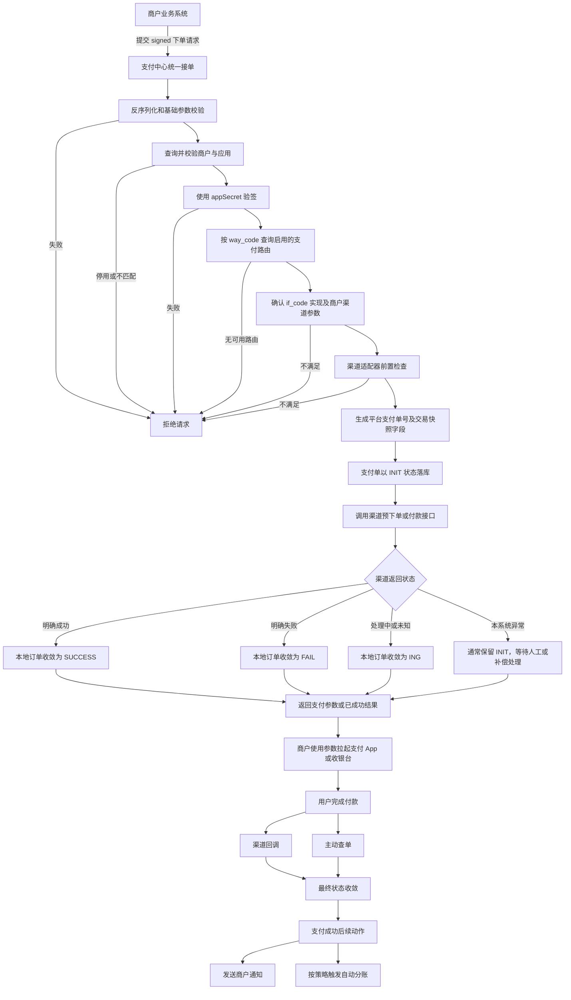
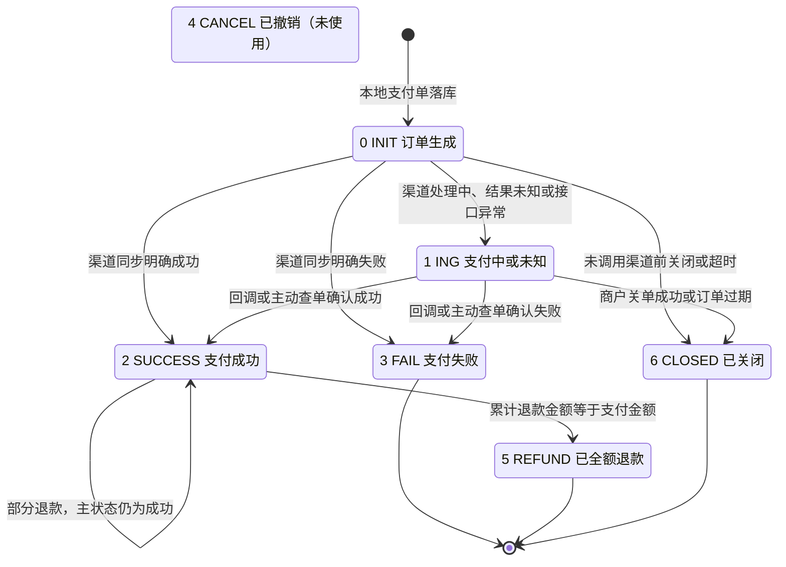
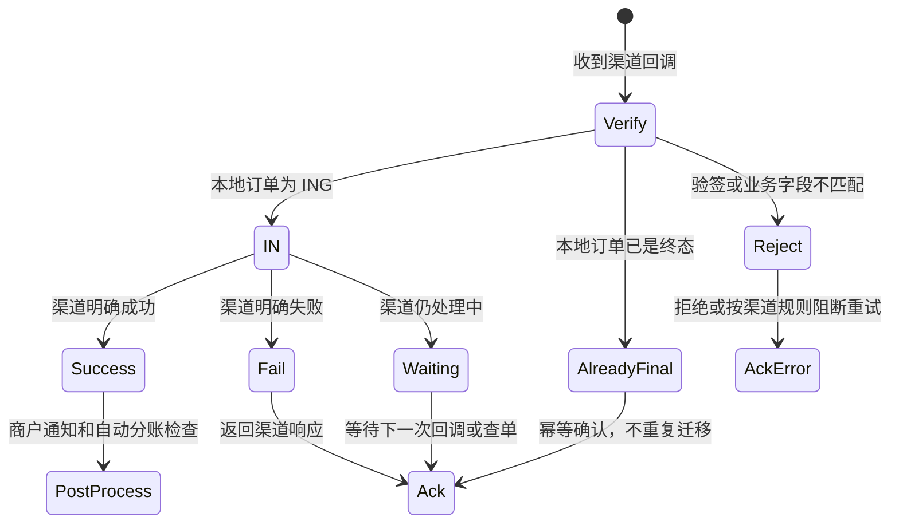
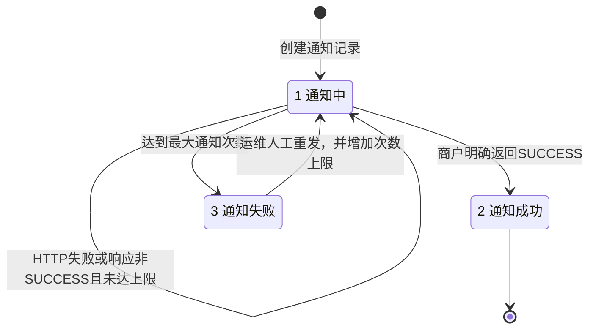
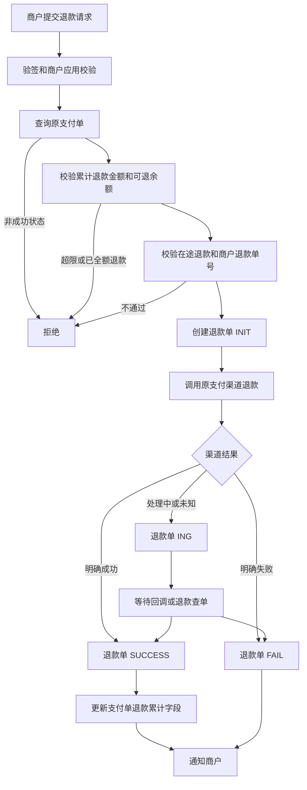
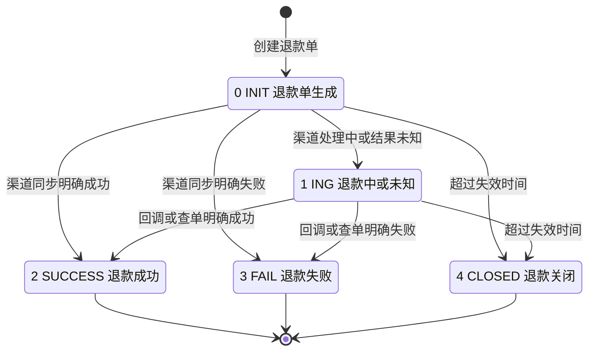
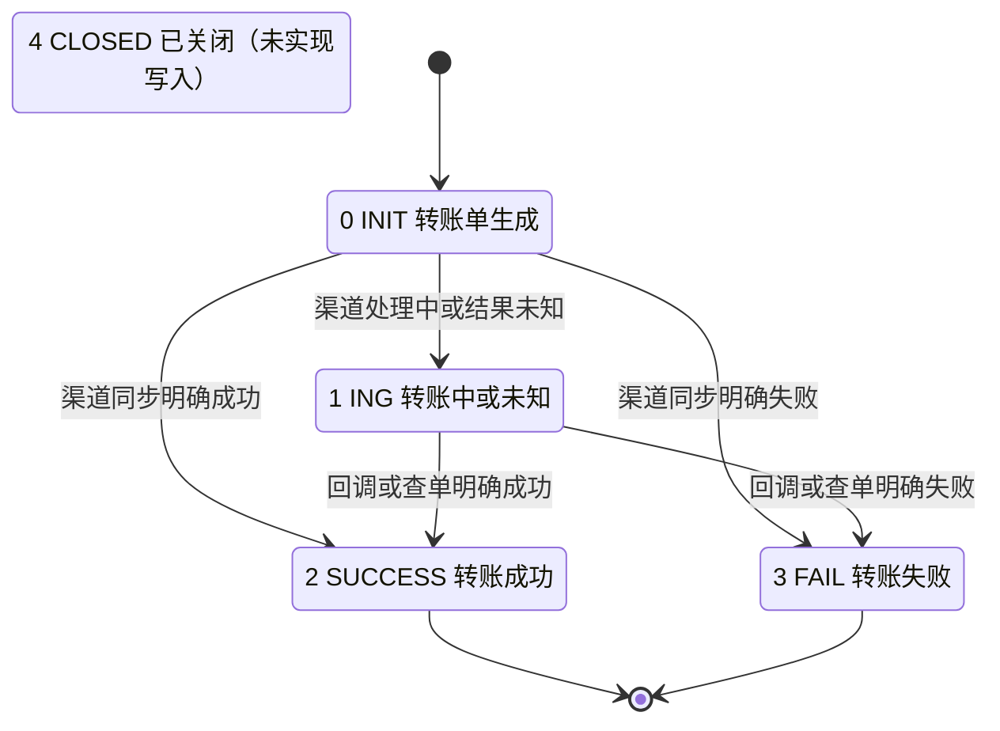
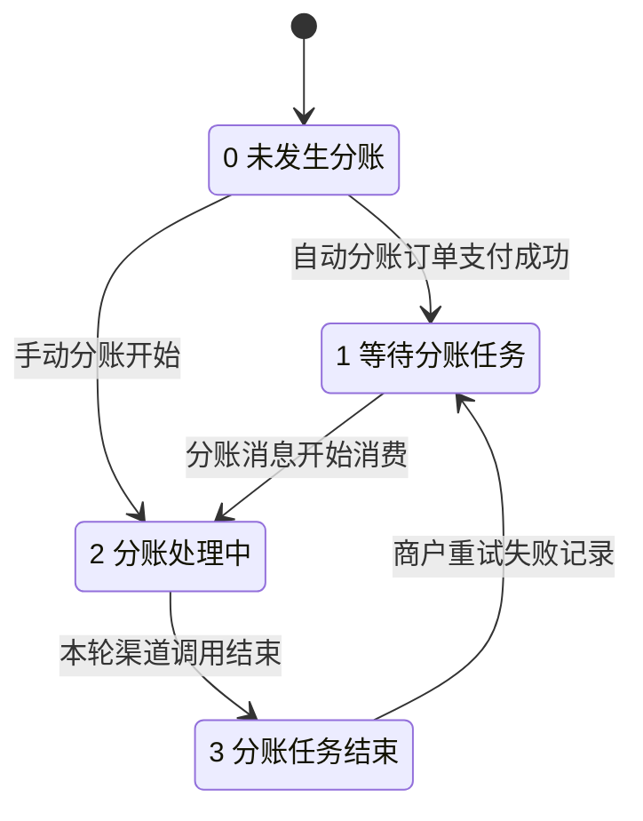
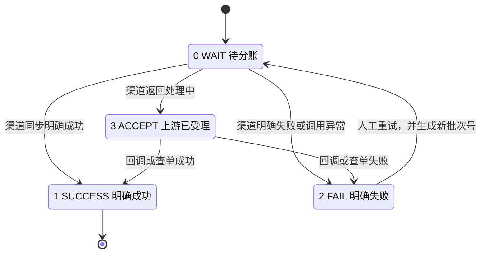

# Jeepay 支付交易域完整学习手册

> 适用目标：通过 Jeepay 掌握聚合支付中心第一层的完整交易链路，为支付研发、交易研发、账务研发和清结算岗位面试做准备。  
> 范围：商户配置、路由、下单、支付结果收敛、渠道回调、主动查单、商户通知、关单、退款、转账和分账。  
> 不展开：Docker、Linux 部署、Nginx、HTTPS 运维，以及项目当前没有实现的复式记账、渠道对账和 T+1 结算。  
> 代码基线：当前项目工作区。本文把“代码当前真实行为”和“生产环境推荐做法”分开说明，避免把演示实现当成完整资金系统。

## 阅读路线

第一次阅读建议按下面顺序，不要直接从代码细节开始：

1. 第 1～3 节：建立资金流、交易流和消息流的全局模型；
2. 第 4～6 节：掌握下单入口、路由、落库和支付状态机；
3. 第 7～10 节：掌握回调、查单、通知、关单和过期；
4. 第 11～13 节：掌握退款、转账和分账的独立状态机；
5. 第 15～18 节：用场景、异常和面试题自测；
6. 第 19～20 节：回到代码逐层阅读并完成验收。

## 1. 先用一句话建立全局认识

支付中心交易层的核心任务不是简单调用微信或支付宝接口，而是：

> 安全识别商户和应用，为订单选择正确的支付通道，创建本地交易凭证，并把来自同步响应、异步回调和主动查单的多种结果，可靠且幂等地收敛到一个最终状态。

支付成功后，再分别处理：

- 通知商户，使商户能够继续履约；
- 退款，把已支付资金原路退回；
- 分账，把交易收入分配给多个接收方；
- 转账，作为独立代付业务向指定账户付款。

支付、退款、分账都成功，也不代表商户已经完成结算。结算属于后续资金核算层，不在 Jeepay 当前交易模块内。

## 2. 系统参与者与资金、消息方向

| 参与者 | 在链路中的职责 |
|---|---|
| 付款用户 | 在微信、支付宝、银联或收银台完成付款 |
| 商户业务系统 | 创建业务订单，调用支付中心下单、退款、转账，并接收结果通知 |
| 支付中心 | 商户鉴权、路由、订单管理、结果收敛、退款、转账、分账和通知 |
| 支付机构或收单机构 | 创建渠道订单、扣款、退款、出款，并通过回调或查询接口返回结果 |
| 清算网络或银行 | 实际完成跨机构资金清算和最终入账，不属于 Jeepay 当前模块 |

一次支付中有三条不同的“流”：

```text
资金流：付款用户 → 支付机构/清算机构 → 商户或平台资金账户
交易流：商户业务单 → 支付中心支付单 → 渠道支付单
消息流：支付中心 → 渠道预下单；渠道 → 回调；支付中心 → 商户通知
```

学习时不要只看接口调用，应同时回答：

- 本地交易凭证什么时候创建？
- 渠道何时真正创建订单？
- 哪个信号可以证明支付最终成功？
- 重复消息到达时，哪条记录防止重复处理？
- 外部调用超时后，系统如何确认结果？

## 3. 第一层涉及的数据库对象

### 3.1 配置主体

| 表 | 作用 | 关键关系 |
|---|---|---|
| `t_mch_info` | 商户主体、类型、服务商归属和启用状态 | `mch_no` 唯一；服务商模式通过 `isv_no` 关联 |
| `t_mch_app` | 商户应用和 API 凭证 | `mch_no → t_mch_info.mch_no`；`app_id + app_secret` 用于验签 |
| `t_isv_info` | 服务商主体 | `isv_no` 唯一 |
| `t_pay_way` | 支付产品定义，例如 JSAPI、条码、H5 | `way_code` 表示用户怎样付 |
| `t_pay_interface_define` | 上游接口能力定义，例如 `wxpay`、`alipay` | `if_code` 表示系统调用哪套渠道实现 |
| `t_pay_interface_config` | 具体商户、应用与接口的参数和密钥配置 | 普通商户、特约商户、服务商参数分开保存 |
| `t_mch_pay_passage` | 商户应用可用的支付产品、上游接口、费率和状态 | 决定“支付方式 `way_code` 最终走哪个渠道 `if_code`” |

必须牢记：

- `way_code` 回答“用户怎么付”；
- `if_code` 回答“这笔交易由哪套渠道协议和结算链路处理”；
- `mch_no + app_id` 回答“是谁在调用支付中心”；
- 支付订单会保存路由结果、费率和费率金额快照，后续配置变更不回溯修改历史订单。

### 3.2 交易主体

| 表 | 作用 | 关键唯一键或关联 |
|---|---|---|
| `t_pay_order` | 支付交易聚合根 | 主键 `pay_order_id`；唯一键 `mch_no + mch_order_no` |
| `t_refund_order` | 退款交易聚合根 | 主键 `refund_order_id`；唯一键 `mch_no + mch_refund_no`；关联 `pay_order_id` |
| `t_transfer_order` | 独立转账或代付交易 | 主键 `transfer_id`；唯一键 `mch_no + mch_order_no` |
| `t_mch_notify_record` | 向商户发送结果的记录 | 唯一键 `order_id + order_type` |
| `t_pay_order_division_record` | 单笔支付对单个接收方的分账记录 | 多条记录可共享 `batch_order_id` |
| `t_mch_division_receiver_group` | 分账接收方分组 | `auto_division_flag` 表示自动分账组 |
| `t_mch_division_receiver` | 已绑定到上游渠道的接收方账号 | 同时受 `mch_no + app_id + if_code` 约束 |
| `t_order_snapshot` | 请求和响应报文快照预留表 | DDL 存在，但当前 Java 业务没有使用 |

三个订单号必须分清：

- 商户订单号：例如 `mch_order_no`、`mch_refund_no`，由商户系统生成，用于业务侧幂等；
- 平台订单号：例如 `pay_order_id`、`refund_order_id`、`transfer_id`，由支付中心生成；
- 渠道订单号：例如 `channel_order_no`，由支付机构生成，用于渠道查单、对账和售后。

## 4. 请求进入支付中心后发生什么

以统一支付下单为例，支付中心不是“相信请求里的配置”，而是利用请求中的身份和产品标识去查询后台可信配置。

### 4.1 参数解析和基础校验

支付中心先完成：

1. 将 HTTP 请求体转换成对应业务请求对象；
2. 校验必填字段；
3. 要求支付金额大于等于 1 分；
4. 校验分账模式只能是 `0、1、2`；
5. 如果商户传入异步通知地址或页面跳转地址，仅允许 `http://` 或 `https://`。

支付金额在系统内部统一使用“分”，避免浮点数精度问题。订单默认两小时过期；商户明确传入 `expiredTime` 时，按秒计算新的失效时间。

### 4.2 商户和应用鉴权

所有商户 API 都先执行统一验签流程：

1. 商户号和 `appId` 不能为空；
2. 根据两者查询商户和应用的配置上下文；
3. 商户必须存在且处于启用状态；
4. 应用必须存在且处于启用状态；
5. 应用的 `mch_no` 必须与请求商户号一致；
6. 使用应用密钥建立待验签报文；
7. 移除报文中的 `sign` 字段；
8. 按统一规则重新计算签名，并与请求签名比较。

因此，验签不只校验“报文没被修改”，还先确定了调用主体。没有有效商户、有效应用和匹配的密钥，请求不会进入下单流程。

### 4.3 支付方式、接口和通道配置校验

验签通过后，支付中心按 `mch_no + app_id + way_code` 查询启用的商户通道路由。

路由结果至少决定：

- 本次使用哪个渠道接口 `if_code`；
- 当前支付产品的商户费率；
- 后续预下单、退款、查单、关单和分账应使用哪套渠道适配器。

随后还要检查：

1. 渠道接口实现是否存在；
2. 接口是否支持该 `way_code`；
3. 普通商户是否配置了该渠道参数；
4. 特约商户是否配置了子商户参数；
5. 特约商户是否同时配置了服务商参数；
6. 渠道接口自身的前置检查是否通过。

当前实现中，同一应用、支付方式可以存在多个启用路由，但代码并没有明确实现“按成功率、成本或权重轮询”的负载均衡，而是从可用接口中取出一个结果。这与表注释里“允许多个支付接口”的能力声明并不完全等价，是后续可以扩展的学习点。

### 4.4 为什么 `way_code` 和 `if_code` 不能混为一谈

例如用户选择“微信 JSAPI”支付：

- `way_code` 描述交互形态：在微信内拉起支付；
- `if_code` 可能是微信直连、某服务商通道或另一个聚合机构。

用户侧看起来都像微信支付，但资金由谁收单、由谁给商户结算、退款走哪套协议、对账下载什么账单，可能完全不同。

## 5. 统一下单完整链路



### 5.1 订单落库时保存了什么

支付单落库时通常包含：

- 商户、应用和服务商归属；
- 商户订单号、平台支付单号；
- 路由后的 `if_code`；
- 用户选择的 `way_code`；
- 金额、币种；
- 商户费率快照和手续费金额；
- 商品标题、描述、客户端 IP；
- 异步通知地址和页面跳转地址；
- 分账模式；
- 初始支付状态 `INIT`；
- 订单失效时间；
- 创建时间和更新时间。

费率快照的意义是历史可追溯。即使管理员之后修改商户费率，已经创建的支付单仍按创建时费率计算。

### 5.2 本地落库和渠道调用不能组成一个数据库事务

正确顺序是“先形成本地交易凭证，再发起外部调用”，原因是：

- 渠道已经创建订单，但本地没有订单号，会产生无法归属的资金；
- 数据库回滚无法撤销渠道侧已经发生的扣款；
- 渠道超时后，系统需要一个稳定的平台订单号去主动查单。

但本地落库成功不代表渠道调用成功。支付中心必须允许订单停在 `INIT` 或 `ING`，等待回调、查询或人工处理。

### 5.3 渠道返回状态如何映射

Jeepay 在公共层定义了六类渠道响应语义：

| 渠道响应语义 | 含义 | 本地动作 |
|---|---|---|
| `CONFIRM_SUCCESS` | 渠道明确成功 | 进入成功处理 |
| `CONFIRM_FAIL` | 渠道明确失败 | 进入失败处理 |
| `WAITING` | 渠道明确表示处理中 | 进入 `ING`，等待回调或查单 |
| `UNKNOWN` | 超时、网络异常、签名异常，无法确认结果 | 进入 `ING`，不能判失败 |
| `API_RET_ERROR` | 渠道接口返回异常状态 | 进入 `ING`，继续查证 |
| `SYS_ERROR` | 支付中心自身发生不可预期异常 | 通常不改变当前状态，需要补查或人工处理 |

“未知”不是“失败”，这是支付系统最重要的原则之一。渠道请求超时后可能已经扣款，如果直接标失败并重新下单，付款用户可能被重复扣款。

### 5.4 支付单写状态采用条件更新

支付单更新不是简单地按主键覆盖，而是带状态条件：

- 从 `INIT` 推进时，要求数据库中当前状态仍为 `INIT`；
- 从 `ING` 推进到成功、失败或关闭时，要求当前状态仍为 `ING`。

这相当于数据库级 CAS。异步回调和主动查单可能同时到达，只有第一个把 `ING` 改成最终状态的操作成功；后到者发现状态已变化，就不会重复完成同一笔交易。

同步接口明确成功时，业务层会先完成 `INIT → ING`，再完成 `ING → SUCCESS`。这两步位于同一事务中，最终观察到的结果仍是成功，但状态机内部保持了“只有支付中才能进入终态”的一致性约束。

## 6. 支付订单主状态机

### 6.1 状态定义

| 值 | 状态 | 含义 |
|---:|---|---|
| 0 | `INIT` | 本地订单已生成，尚未得到可信的渠道最终结果 |
| 1 | `ING` | 渠道处理中，或当前结果未知 |
| 2 | `SUCCESS` | 支付成功 |
| 3 | `FAIL` | 支付失败 |
| 4 | `CANCEL` | 已撤销；当前业务代码未写入该状态 |
| 5 | `REFUND` | 原支付已累计全额退款 |
| 6 | `CLOSED` | 未支付订单已关闭或过期 |

### 6.2 状态迁移



### 6.3 迁移条件明细

| 源状态 | 目的状态 | 触发条件 | 业务含义 |
|---|---|---|---|
| `INIT` | `ING` | 渠道处理中、结果未知或渠道接口异常 | 结果尚未确定，需要回调或查单 |
| `INIT` | `SUCCESS` | 渠道同步返回明确成功 | 部分付款码或即时支付可在下单响应内完成 |
| `INIT` | `FAIL` | 渠道同步返回明确失败 | 可以认为本次交易失败 |
| `INIT` | `CLOSED` | 未调用渠道的订单被商户关闭，或超过失效时间 | 不允许继续支付 |
| `ING` | `SUCCESS` | 渠道回调或渠道主动查询明确成功 | 交易最终成功 |
| `ING` | `FAIL` | 渠道回调或渠道主动查询明确失败 | 交易最终失败 |
| `ING` | `CLOSED` | 渠道关单成功，或过期任务直接关闭 | 未成功交易结束 |
| `SUCCESS` | `SUCCESS` | 发生部分退款 | 原支付事实仍属于成功交易 |
| `SUCCESS` | `REFUND` | 累计退款金额等于原支付金额 | 用主状态表达“全额退款” |

### 6.4 支付订单的四个状态维度

不要只记 `state`。支付订单同时维护四组状态。

#### 支付主状态 `state`

描述支付交易本身是生成、处理中、成功、失败还是关闭。

#### 退款汇总状态 `refund_state`

| 值 | 含义 | 迁移 |
|---:|---|---|
| 0 | 未发生实际退款 | 首次退款成功后进入 1 或 2 |
| 1 | 部分退款 | 继续退款且累计金额仍小于支付金额 |
| 2 | 全额退款 | 累计退款金额达到支付金额 |

只有退款成功才更新累计退款金额。退款“处理中”不会提前增加 `refund_amount`。

#### 分账状态 `division_state`

| 值 | 含义 | 迁移 |
|---:|---|---|
| 0 | 未发生分账 | 自动任务准备执行，或手动分账开始 |
| 1 | 等待分账任务 | 自动分账消息等待被消费 |
| 2 | 分账处理中 | 某次分账处理已开始 |
| 3 | 分账任务结束 | 本轮调用完成，不代表每个接收方成功 |

#### 通知状态 `notify_state`

| 值 | 含义 | 注意 |
|---:|---|---|
| 0 | 未发送 | 尚未开始第一次通知 |
| 1 | 已发送 | 第一次开始尝试后更新，不代表商户已确认成功 |

商户是否真正收到结果，要看 `t_mch_notify_record.state`。

## 7. 异步回调

### 7.1 回调在系统中的定位

渠道异步回调是支付中心获取最终结果的主要事件来源，但不是唯一来源。

它和下面两个动作不同：

- **主动查单**：支付中心定时或延迟调用渠道查询接口；
- **商户通知**：支付中心把已经确认的结果发送给商户。

回调方向是渠道到支付中心；商户通知方向是支付中心到商户。不能把两者看成同一个流程。

### 7.2 支付回调处理步骤

1. 从回调 URL 或回调报文识别渠道 `ifCode` 和本地订单号；
2. 使用对应渠道适配器解析原始回调；
3. 读取本地支付单；
4. 加载商户、应用和渠道配置；
5. 执行渠道签名验证；
6. 校验回调中的业务字段；
7. 读取当前支付单状态；
8. 若当前为 `ING`，按回调结果执行条件更新；
9. 成功时执行支付成功后续动作；
10. 返回渠道要求的成功响应。

验签通过只证明报文来源可信，还必须检查：

- 回调订单号是否对应本地支付单；
- 渠道商户号或应用标识是否匹配；
- 支付金额和币种是否一致；
- 渠道订单号是否合理；
- 渠道状态是否映射到已知结果；
- 回调 URL 中的订单号是否与报文中的订单号一致。

支付宝适配器当前会在验签后继续比对本地平台单号、支付宝应用 ID 和金额。业务字段不匹配时不会更新订单，并记录错误日志。这种交叉校验在大商户、多应用和沙箱生产配置混用时尤其重要。

### 7.3 回调状态迁移



### 7.4 回调必须处理的并发与乱序

#### 重复回调

同一成功回调可能发送多次。系统依赖：

- 支付单带原状态条件的 CAS；
- 商户通知记录唯一键；
- 分账父状态条件更新；
- 分账记录状态条件更新。

业务上仍必须返回渠道要求的成功响应，避免渠道无休止重试。

#### 回调早于预下单响应

极端并发下，渠道可能已经开始回调，但支付中心尚未完成同步响应后的状态更新。

当前支付回调主体只明确处理 `ING` 状态的订单。如果此时本地仍为 `INIT`，需要特别关注：

- 不能直接丢弃回调；
- 理想做法是记录回调证据并重新查单；
- 或者让状态机支持受控的 `INIT → SUCCESS/FAIL` 迁移；
- 关键是避免已经成功但本地仍停留在 `INIT/ING`。

#### 回调晚于订单关闭

如果本地订单已经过期关闭，而渠道之后回调成功，这是“晚到成功”。此时不能只因为本地状态不是 `ING` 就静默忽略。生产系统应进入差错队列，执行主动查单、退款、补单或人工复核。

#### 成功与失败回调乱序

不要按消息到达顺序直接覆盖状态。必须调用渠道查询确认最终事实，并保留回调原文和状态迁移审计。

### 7.5 同步跳转页不能作为支付成功的唯一依据

用户支付完成后，浏览器可能被跳转到商户的 `returnUrl`。该跳转主要用于展示结果和恢复用户体验。

真正的业务依据应是：

- 服务端收到并验证过的渠道异步回调；
- 或者支付中心主动查单得到的最终结果；
- 后续正式生产系统还应有渠道对账。

商户不能只依赖前端跳转页面的状态去发货。

## 8. 主动查单和补偿

### 8.1 商户查单接口和系统查单是两件事

Jeepay 面向商户的支付、退款和转账查询接口，主要按商户身份读取本地数据库中的订单并返回，不负责每次都实时访问渠道。

内部补偿任务才会调用渠道查询接口。

因此要区分：

- 商户调用 `/api/pay/query`：读取支付中心当前记录；
- 支付中心内部补单任务：调用渠道接口获取更权威的最终结果。

### 8.2 延迟查单

当渠道同步返回“处理中、结果未知或接口异常”，且渠道适配器认为需要继续查询时，支付中心会发送延迟消息。

当前行为：

1. 首次延迟 5 秒；
2. 消息消费者读取支付单；
3. 只有订单仍为 `ING` 时才调用渠道查询；
4. 查询结果明确成功或失败，则执行 CAS 和后续动作；
5. 查询结果仍为未知或处理中，则继续发送延迟消息；
6. 单条 MQ 查单链最多查询 6 次；
7. 达到上限后不再由该 MQ 链继续发送。

“最多 6 次”查的是支付结果，不是向商户转发预支付参数的次数，也不是固定等待 6 秒。

### 8.3 定时补单扫描

项目还有独立的定时任务：

- 每分钟扫描一次；
- 找出处于 `ING` 且创建超过一定时间的支付单；
- 每页最多处理 100 条；
- 对每笔订单调用渠道查询；
- 明确成功则更新并执行成功后续动作；
- 明确失败则更新失败；
- 仍未知则下一轮任务继续处理。

当前支付补单任务筛选的是创建超过 10 分钟的 `ING` 订单，因此它与 6 次延迟消息链形成了两级兜底。

### 8.4 查单也不能无脑处理

生产设计还需处理：

- 查询出现系统错误时使用退避，避免打爆渠道；
- 单批失败不能让整个扫描任务永久中断；
- 查询任务按数据分片，避免单机全量扫描；
- 查询结果和回调结果并发时继续使用 CAS；
- 已过期但可能成功的订单不能简单关闭后遗忘；
- 连续多日未知的订单进入人工差错队列。

### 8.5 当前实现中值得特别注意的空档

如果渠道创建订单时返回“支付中心自身异常”，订单可能停留在 `INIT`。延迟查单和常规补单主要筛选 `ING`，这个订单可能永远不会被自动查询。

这是学习时必须区分的“代码事实”和“生产改进点”：

- 代码事实：`SYS_ERROR` 通常不更新支付状态；
- 生产建议：对调用结果未知且本地为 `INIT` 的订单建立补偿索引，覆盖原始报文快照，并支持按平台单号恢复查询。

## 9. 商户异步通知

### 9.1 支付成功后的动作顺序

支付成功后，支付中心通常会：

1. 重新读取最终支付单；
2. 判断是否启用自动分账；
3. 如果商户配置了通知地址，创建通知记录；
4. 将通知消息发送到 MQ；
5. 消费者向商户发送签名后的支付结果；
6. 根据商户响应决定成功或重试。

### 9.2 通知记录的唯一性

通知记录以 `order_id + order_type` 唯一：

- `order_type=1`：支付；
- `order_type=2`：退款；
- `order_type=3`：转账。

同一订单同一类型最多存在一条通知记录，所有重试都复用该记录。

### 9.3 通知内容

通知内容包括：

- 平台订单号；
- 商户订单号；
- 商户号和应用 ID；
- 金额、币种和交易状态；
- 渠道订单号；
- 请求时间；
- 使用应用密钥计算出的签名。

商户必须先验签，再判断是否是自己的订单，并检查金额和订单状态，最后执行业务处理。

### 9.4 当前支付通知的范围

代码中支付成功会创建商户通知，但支付失败路径没有直接调用支付商户通知。退款和转账在明确成功或明确失败时会创建通知。

因此面试时要准确表述：

- “支付成功会异步通知商户”；
- “支付失败时商户应以同步响应或主动查询结果为准，当前项目没有统一的支付失败异步通知”。

### 9.5 重试规则

默认最多通知 6 次：

1. 第一次立即发送；
2. 失败后延迟 30 秒；
3. 再失败延迟 60 秒；
4. 再失败延迟 90 秒；
5. 再失败延迟 120 秒；
6. 再失败延迟 150 秒；
7. 第 6 次仍失败时标记通知失败。

商户必须返回内容为 `SUCCESS` 的响应，其他内容都视为失败。当前比较不忽略前后空白，因此不要返回带 JSON 包装或额外说明的 `SUCCESS`。

### 9.6 通知状态机



### 9.7 通知失败不等于支付失败

支付订单成功和通知成功是两个不同维度。

- 支付成功、通知暂时失败：订单仍成功，等待重试；
- 支付成功、通知最终失败：订单仍成功，需要人工补发或商户主动查单；
- 不能因为 HTTP 通知失败而回滚支付单。

### 9.8 当前通知实现的风险

- MQ 延迟重试链没有独立扫描“通知中”记录的定时任务；消息丢失时记录可能长期停留在通知中。
- 通知记录更新没有检查消息版本或投递序号，同一消息被并发消费时存在重复发送和次数竞争。
- 没有事务消息或 Outbox 时，订单状态更新成功但通知消息发送失败，会产生业务补偿空档。

这些都是适合二次开发和面试讨论的稳定性改进点。

## 10. 关单与过期

### 10.1 商户主动关单

关单只允许处理 `INIT` 和 `ING` 状态。

#### `INIT` 关单

如果还没有与渠道建立不可逆支付关系，支付中心可以直接把本地订单从 `INIT` 改成 `CLOSED`。

#### `ING` 关单

订单已经进入渠道，支付中心必须调用渠道关单接口：

- 渠道明确关闭成功，本地才执行 `ING → CLOSED`；
- 渠道关闭失败或状态无法确认，本地不能直接假设用户不会再付款；
- 最好随后再用查单确认最终状态。

### 10.2 定时过期

支付订单默认两小时过期。当前定时任务会把已经超过 `expired_time` 且仍为 `INIT` 或 `ING` 的本地订单直接改为 `CLOSED`。

需要注意：当前支付过期任务没有先调用渠道关单接口。生产环境中，这可能导致：

- 本地已关闭，但渠道仍可付款；
- 用户关闭页面前已经成功付款；
- 渠道稍后成功回调，而本地状态已不是 `ING`。

因此“本地过期关闭”不等于“渠道一定无法支付”。应在渠道侧关闭或通过查询、对账确认，并对晚到成功建立处理流程。

## 11. 退款

### 11.1 退款和关单不是一回事

- 关单：用户还没成功付款，阻止或终止后续付款；
- 退款：已经成功付款，把全部或部分资金退回用户；
- 撤销或冲正：通常用于撤销授权、撤销未清算交易，具体语义取决于渠道。

Jeepay 当前主状态中虽然定义了 `CANCEL=4`，但没有实际业务代码写入。学习时不要把“撤销”当作当前已完整实现的退款替代流程。

### 11.2 退款申请前置检查

商户申请退款时，支付中心会检查：

1. 商户和应用验签通过；
2. 原支付单存在且属于当前商户；
3. 原支付单状态必须是 `SUCCESS`；
4. 原支付单不能已经全额退款；
5. 本次退款金额不能超过剩余可退款金额；
6. 同一支付单不能已经有处理中退款；
7. 历史成功退款金额加本次金额不能超过原支付金额；
8. 商户退款单号不能重复；
9. 原渠道必须支持退款；
10. 商户渠道参数必须有效。

退款必须是一个独立交易对象，不能直接修改支付单金额，因为：

- 一笔支付可以多次部分退款；
- 每次退款有自己的渠道状态和失败原因；
- 退款请求可能超时但渠道实际成功；
- 退款必须支持独立查询、通知和审计。

### 11.3 退款完整流程



### 11.4 退款单状态

| 值 | 状态 | 含义 |
|---:|---|---|
| 0 | `INIT` | 退款单已生成，尚未获得可信渠道结果 |
| 1 | `ING` | 渠道处理中或结果未知 |
| 2 | `SUCCESS` | 退款成功 |
| 3 | `FAIL` | 退款失败 |
| 4 | `CLOSED` | 退款任务关闭或过期 |



### 11.5 退款成功后如何回写支付单

退款成功时，必须在一个事务中完成：

1. 把退款单从 `ING` 条件更新为 `SUCCESS`；
2. 给原支付单 `refund_times` 加一；
3. 累加 `refund_amount`；
4. 判断累计退款是否达到原支付金额；
5. 部分退款时把 `refund_state` 设为 `1`；
6. 全额退款时把 `refund_state` 设为 `2`；
7. 全额退款同时把支付主状态从 `SUCCESS` 改为 `REFUND`。

更新支付单时还会在数据库条件中校验：

```text
原状态必须为 SUCCESS
且原累计退款金额 + 本次退款金额 <= 支付金额
且退款汇总状态尚未达到全额退款
```

这为并发退款提供了最后一道金额防线。

### 11.6 退款结果补偿

退款单处于 `ING` 时：

- 渠道退款回调可以把它推进到成功或失败；
- 定时补单任务每分钟扫描 `ING` 退款单；
- 通过原支付渠道的退款查询能力确认结果；
- 成功或失败后再通知商户。

当前退款补单任务没有显式的重试次数上限，会持续扫描退款中的订单，直到过期任务改变状态或渠道给出明确结果。

### 11.7 当前退款实现值得注意的风险

#### 在途退款并发检查

申请前通过查询“是否存在 `ING` 退款单”来避免并发退款。但两个请求可能几乎同时完成查询，都认为没有在途退款，然后都调用渠道。

最终支付单在“退款成功回写”时会用金额条件阻止累计金额超限，但此时渠道退款可能已经发生。生产系统应在申请阶段使用更强的数据库约束、支付单行锁、退款额度冻结或幂等占位机制。

#### 退款过期直接关闭

当前退款单默认两小时过期，过期任务会把 `INIT/ING` 退款任务直接改为 `CLOSED`。如果渠道稍后才真正退款成功，本地可能已经关闭。

生产环境应：

- 过期前主动查询渠道；
- 关闭时记录渠道确认结果；
- 对晚到成功建立差错处理；
- 不能仅按本地定时器认定渠道未退款。

#### 退款失败后的再次退款

退款单失败后不能修改同一退款单金额，也不能复用同一个商户退款单号。若仍有可退余额，应使用新的商户退款单号创建新的退款交易，并保留前一次失败的审计记录。

## 12. 转账或代付

### 12.1 转账与支付、退款的区别

| 业务 | 资金来源 | 是否必须关联原支付单 | 典型目的 |
|---|---|---|---|
| 支付 | 用户付款 | 否 | 收取交易款 |
| 退款 | 原支付交易 | 是 | 原路退回 |
| 转账 | 平台或商户指定资金 | 否 | 向银行卡、零钱或支付宝账户付款 |

退款必须使用原支付渠道并受原订单金额约束；转账是独立付款事务，但实际生产系统还必须校验商户余额、冻结金额、收款人、风控和限额。Jeepay 当前交易层没有完整资金账户和余额扣减模型。

### 12.2 转账请求链路

1. 商户提交签名转账请求；
2. 校验商户和应用；
3. 校验商户订单号没有重复；
4. 校验通知 URL；
5. 商户明确指定渠道 `ifCode`；
6. 校验应用是否开通该渠道；
7. 校验渠道是否支持对应入账方式；
8. 生成转账单并以 `INIT` 落库；
9. 渠道适配器执行前置检查；
10. 调用渠道转账接口；
11. 根据渠道结果进入成功、失败或转账中；
12. 渠道回调、主动查单继续收敛结果；
13. 成功或失败后向商户发送通知。

### 12.3 转账单状态

| 值 | 状态 | 含义 |
|---:|---|---|
| 0 | `INIT` | 转账单生成，尚未获得可信结果 |
| 1 | `ING` | 转账中或结果未知 |
| 2 | `SUCCESS` | 出款成功 |
| 3 | `FAIL` | 出款失败 |
| 4 | `CLOSED` | 已定义，但当前没有转账过期关闭任务写入 |



### 12.4 转账补偿

转账补单任务每分钟扫描处于 `ING` 的转账单，调用渠道查询：

- 明确成功：更新为 `SUCCESS` 并通知商户；
- 明确失败：更新为 `FAIL` 并通知商户；
- 仍未知：保留 `ING`，下一轮继续查询。

当前没有类似支付 MQ 链的“最多 6 次”计数，也没有转账过期关闭任务。

### 12.5 转账最危险的问题

调用渠道出款超时后，订单可能已经成功。此时如果直接标记失败并让商户重新发起一笔转账，可能造成重复出款。

正确原则：

- 转账请求超时不是转账失败；
- 必须按原转账单号去渠道查询；
- 商户订单号必须在整个重试窗口内保持幂等；
- 生产资金系统还需有账户余额冻结和出款流水。

## 13. 分账

### 13.1 分账的含义

分账是把一笔支付交易产生的可分配收入，按规则分配给平台、服务商、门店、供应商等接收方。

分账不等于结算：

- 分账决定交易收入归谁；
- 结算决定可结算资金何时真正打出；
- 分账成功也不代表接收方已经可以自由提现。

### 13.2 分账前置数据

执行分账之前需要：

1. 创建接收方分组；
2. 将接收方账号绑定到指定上游渠道；
3. 配置接收方关系和分账比例；
4. 确保接收方状态可用；
5. 支付单属于支持分账的渠道；
6. 支付单已经成功。

接收方记录依赖：

- 商户号；
- 应用 ID；
- 渠道接口 `if_code`；
- 接收方分组；
- 账号类型和账号；
- 渠道关系类型；
- 分账比例；
- 启用状态。

### 13.3 自动分账

支付单创建时，`division_mode` 决定策略：

- `0`：不允许分账；
- `1`：支付成功后自动分账；
- `2`：支付成功由商户手动发起分账。

自动分账流程：

1. 支付确认成功；
2. 如果模式为自动分账；
3. 用条件更新把父订单分账状态从 `0` 改成 `1`；
4. 发送延迟 80 秒的分账消息；
5. 消费者开始本轮分账；
6. 父状态从 `1` 改成 `2`；
7. 按自动分账组查询有效接收方；
8. 计算每个接收方的比例和金额；
9. 生成分账记录并保存；
10. 调用渠道分账接口；
11. 更新单条记录结果；
12. 父状态改为 `3`。

80 秒延迟的目的，是尽量避免支付成功后的短暂状态、资金可见性或上游数据尚未完全就绪。

### 13.4 手动分账

手动分账必须同时满足：

- 支付单状态为 `SUCCESS`；
- 父分账状态为 `0`；
- 分账模式为 `2`；
- 接收方或接收方组属于当前商户；
- 接收方在当前应用和渠道下可用；
- 比例在 0 到 1 之间。

### 13.5 可分配金额

当前实现按以下公式计算：

```text
可分配金额 =
  支付金额
  - 商户手续费
  - 已成功退款金额
  - 已成功分账金额
```

如果结果小于等于 0，则按 0 处理。

这说明退款和分账存在资金竞争关系。退款发生在分账前，会减少可分配基数；分账发生在退款前，则退款可能需要向已分账接收方追偿，或者由平台先行垫付。

### 13.6 分账金额计算

1. 汇总本次接收方的分账比例；
2. 先计算一个总可分配上限；
3. 按每个接收方比例计算金额；
4. 金额向下取整到分；
5. 如果一个接收方计算金额超过剩余额度，则截断为剩余额度；
6. 保证所有记录合计不超过可分配金额；
7. 一条记录保存接收账号、账号名、比例等快照。

保存账号快照的目的是：之后修改接收方配置，不会改变历史分账记录。

### 13.7 父订单分账状态



必须强调：

> 父订单 `division_state=3` 表示“本轮任务已经结束”，并不表示每个接收方都成功。真实结果要按 `record_id` 查看。

### 13.8 单条分账记录状态

| 值 | 状态 | 含义 |
|---:|---|---|
| 0 | `WAIT` | 待调用渠道 |
| 1 | `SUCCESS` | 渠道明确分账成功 |
| 2 | `FAIL` | 渠道明确失败或调用异常 |
| 3 | `ACCEPT` | 上游已受理，等待异步结果 |



### 13.9 分账补偿

分账记录进入上游已受理状态后：

- 渠道可以异步回传每条分账结果；
- 定时任务会扫描创建超过 5 分钟的已受理记录；
- 按系统分账批次号查询上游；
- 明确成功的记录改为成功；
- 明确失败的记录改为失败；
- 仍不明确的记录留待下一轮。

商户对失败记录发起重试时：

1. 父订单从任务结束改回等待任务；
2. 所有失败记录改回待分账；
3. 重新生成一个分账批次号；
4. 再通过 MQ 发起渠道分账。

重新生成批次号可以降低上游将重试误解为同一旧请求的风险。

### 13.10 分账退款竞争

如果支付成功并发生分账，之后又发生退款，可能产生：

- 商户余额已经减少，退款资金不足；
- 需要接收方退回分账资金；
- 平台先行垫付；
- 形成负余额或下期扣回；
- 上游渠道不支持已分账部分退款。

Jeepay 当前交易模块只计算剩余可分配金额并记录分账结果，没有完整解决结算后追偿和资金账户问题。

## 14. 核销在交易层中的位置

核销通常不是支付交易主状态机的一部分。

### 14.1 券码或权益核销

典型流程：

```text
支付成功
  → 发放优惠券或权益
  → 用户到店或线上使用
  → 商户业务系统核销
  → 核销记录变为已使用
```

核销属于商户业务履约系统。支付中心最多提供支付成功事件和平台订单号，业务系统应通过自己的业务订单号与支付单关联。

### 14.2 资金核销

如果“核销”指的是银行资金到账后与应收记录匹配，它属于对账、清分和账务处理，不属于支付下单或退款状态机。

## 15. 典型业务场景与状态组合

| 场景 | 支付主状态 | 退款汇总 | 分账状态 | 关联交易状态 |
|---|---|---|---|---|
| 刚创建支付单 | `INIT` | `0` | `0` | 无其他交易 |
| 等待用户付款 | `ING` | `0` | `0` | 等待回调或查单 |
| 支付明确失败 | `FAIL` | `0` | `0` | 不触发支付成功分账 |
| 未支付订单过期 | `CLOSED` | `0` | `0` | 无成功退款 |
| 支付成功、无扩展业务 | `SUCCESS` | `0` | `0` | 通知可能成功或失败 |
| 支付成功、自动分账等待 | `SUCCESS` | `0` | `1` | 自动分账消息待消费 |
| 支付成功、分账处理中 | `SUCCESS` | `0` | `2` | 有父任务正在执行 |
| 分账任务结束但部分失败 | `SUCCESS` | `0` | `3` | 记录可能同时有 `1/2/3` |
| 一笔退款处理中 | `SUCCESS` | 原值 | 原值 | 退款单 `ING` |
| 部分退款成功 | `SUCCESS` | `1` | 原值 | 退款单 `SUCCESS` |
| 全额退款成功 | `REFUND` | `2` | 原值 | 退款单 `SUCCESS` |
| 转账出款成功 | 不适用 | 不适用 | 不适用 | 转账单 `SUCCESS` |
| 商户通知暂时失败 | 支付状态不变 | 不变 | 不变 | 通知记录 `ING` |
| 商户通知最终失败 | 支付状态不变 | 不变 | 不变 | 通知记录 `FAIL` |

## 16. 正常与异常场景总表

| 场景 | 正确处理原则 | 错误做法 |
|---|---|---|
| 商户重复提交相同订单号 | 根据唯一约束识别重复，按接口幂等策略返回已有结果或明确冲突 | 创建第二笔本地订单 |
| 商户签名错误 | 拒绝处理 | 先落库再验签 |
| 应用已停用 | 拒绝下单 | 仅校验商户状态 |
| 路由不存在 | 不接受交易 | 随机选择任意渠道 |
| 渠道参数缺失 | 拒绝下单或禁止该通道 | 等问题在渠道调用时才暴露 |
| 渠道预下单超时 | 订单进入未知，按原平台单号查询 | 直接标失败并重新下单 |
| 回调早于同步响应 | 保存证据并查单，或受控处理 `INIT` | 直接丢弃回调 |
| 重复成功回调 | CAS 和唯一记录保证幂等，返回渠道成功响应 | 重复通知商户、重复分账 |
| 成功回调后本地已关闭 | 进入差错处理，主动查单和退款/补单 | 静默忽略晚到付款 |
| 商户通知超时 | 保留通知记录并重试 | 回滚支付成功状态 |
| 商户返回 JSON 而不是 SUCCESS | 视为通知未确认，继续重试 | 将任意 200 响应视为成功 |
| 部分退款余额不足 | 拒绝本次退款 | 让累计退款超过原支付 |
| 退款请求超时 | 保持退款中并查询 | 直接再次退款 |
| 退款成功但本地事务失败 | 通过渠道查询和补偿重建本地一致性 | 假设数据库失败代表资金没动 |
| 出款请求超时 | 查询原转账单 | 直接重新出款 |
| 分账部分失败 | 按记录逐个补偿 | 只改父订单为结束就算完成 |
| MQ 重复消费 | 使用条件更新和唯一键 | 只依赖消息只消费一次 |
| 服务在状态更新后崩溃 | 有 Outbox、扫描和人工补偿 | 假设数据库与 MQ 原子一致 |

## 17. 当前 Jeepay 实现的边界和风险

这一节用于区分“项目已经做了”与“真实生产系统还需要做”。

### 17.1 当前已经具备

- 商户、应用和服务商配置；
- 请求验签和商户应用状态校验；
- 支付方式到渠道接口的路由；
- 支付、退款、转账和分账的统一抽象；
- 条件更新和重复回调的大部分幂等保护；
- 支付、退款和转账的异步回调；
- 支付 MQ 延迟查单和定时补单；
- 退款和转账定时查单；
- 商户通知去重和重试；
- 分账受理查询和失败重发。

### 17.2 当前没有完整实现

- 渠道账单下载和逐笔对账；
- 支付、退款、手续费、分账的复式记账；
- 商户资金账户和余额冻结；
- 清分、结算批次、出款单和结算退票；
- 结算后退款追偿；
- 跨渠道统一差错平台；
- 自动化晚到支付的冲正和人工处理台；
- `t_order_snapshot` 的 Java 业务落库；
- 支付 `CANCEL=4` 的实际写入流程；
- 转账 `CLOSED=4` 的实际过期关闭流程。

### 17.3 当前实现的具体风险点

1. 同一应用和支付方式配置多个路由时，没有明显的权重和故障转移策略。
2. `SYS_ERROR` 后订单可能停在 `INIT`，常规补单只扫描 `ING`。
3. 支付回调只明确处理 `ING`，早到回调存在 `INIT` 竞态。
4. 支付过期任务直接关闭本地 `INIT/ING` 订单，没有先确认渠道关闭。
5. 退款在途检查在申请阶段存在并发窗口。
6. 退款过期任务也可能把实际正在处理的退款直接关闭。
7. 转账没有资金余额和冻结校验。
8. 商户通知依赖 MQ 链，没有独立扫描通知中的记录。
9. 商户通知记录更新没有消息版本检查，可能出现并发重复发送。
10. 支付状态更新、分账消息发送和通知消息发送没有事务 Outbox。
11. 自动分账任务异常时父状态可能停留在处理中，需要额外监控和修复。
12. 分账父订单完成任务，不等于每个接收方都成功。

## 18. 面试时必须能讲清的十个问题

### 问题 1：为什么先落本地单，再调用渠道？

因为外部渠道无法加入本地数据库事务。先落本地单可以：

- 固定平台订单号；
- 在超时和异常后仍能按订单号查询渠道；
- 防止渠道成功但本地无法归属；
- 保证回调有稳定对象可以匹配。

### 问题 2：为什么渠道超时不能直接判失败？

网络超时只说明没有及时收到响应，不代表渠道没有创建或完成交易。直接判失败并重新下单可能出现重复扣款。

### 问题 3：`INIT` 和 `ING` 有什么区别？

- `INIT`：本地交易已创建，但还没有可信的支付处理结果；
- `ING`：渠道处理中或结果未知，系统已进入等待回调或查单阶段。

### 问题 4：为什么回调不是把状态改为 `ING`？

回调是确认结果的信号。正常路径是 `ING → SUCCESS/FAIL`，`ING` 是等待最终结果的状态。

### 问题 5：为什么需要主动查单？

回调可能延迟、丢失或乱序。主动查单用于解决同步响应未知、回调缺失和最终状态收敛问题。

### 问题 6：如何保证重复回调幂等？

- 交易单按订单号唯一定位；
- 状态更新带原状态条件；
- 通知记录按订单和类型唯一；
- 分账父状态和记录状态都使用条件更新。

### 问题 7：商户通知成功和订单支付成功是什么关系？

是两个独立状态。支付成功是资金交易事实，通知成功是消息送达事实。通知失败不能回滚支付，应重试和人工补发。

### 问题 8：为什么退款必须是独立订单？

因为支持多次部分退款、独立渠道状态、独立超时、独立通知、累计金额约束和审计。

### 问题 9：退款请求超时后怎么办？

保留退款单为处理中，使用原退款单号查询渠道，确认成功或失败后再做后续处理，不能盲目再次发起退款。

### 问题 10：分账是否等于结算？

不等于。分账决定一笔交易收入在多个参与方之间如何分配；结算决定可结算资金何时出款。分账成功不代表接收方已经完成结算。

## 19. 建议的代码阅读顺序

### 第一步：入口和商户身份

1. `jeepay-payment/src/main/java/com/jeequan/jeepay/pay/ctrl/ApiController.java`
2. `jeepay-payment/src/main/java/com/jeequan/jeepay/pay/ctrl/payorder/UnifiedOrderController.java`
3. `jeepay-payment/src/main/java/com/jeequan/jeepay/pay/ctrl/payorder/AbstractPayOrderController.java`

阅读目标：

- 请求如何反序列化；
- 商户和应用如何校验；
- 签名如何计算；
- 产品如何路由到渠道。

### 第二步：支付状态

1. `jeepay-core/src/main/java/com/jeequan/jeepay/core/entity/PayOrder.java`
2. `jeepay-service/src/main/java/com/jeequan/jeepay/service/impl/PayOrderService.java`
3. `jeepay-payment/src/main/java/com/jeequan/jeepay/pay/service/PayOrderProcessService.java`

阅读目标：

- 状态常量；
- 条件更新；
- 成功、失败和关闭迁移；
- 退款累计金额回写；
- 自动分账触发。

### 第三步：支付结果收敛

1. `jeepay-payment/src/main/java/com/jeequan/jeepay/pay/ctrl/payorder/ChannelNoticeController.java`
2. `jeepay-payment/src/main/java/com/jeequan/jeepay/pay/service/ChannelOrderReissueService.java`
3. `jeepay-payment/src/main/java/com/jeequan/jeepay/pay/mq/PayOrderReissueMQReceiver.java`
4. `jeepay-payment/src/main/java/com/jeequan/jeepay/pay/task/PayOrderReissueTask.java`
5. `jeepay-payment/src/main/java/com/jeequan/jeepay/pay/task/PayOrderExpiredTask.java`

阅读目标：

- 回调与查单如何共享状态迁移；
- 5 秒、6 次和 10 分钟扫描的真实关系；
- 过期任务的风险。

### 第四步：商户通知

1. `jeepay-payment/src/main/java/com/jeequan/jeepay/pay/service/PayMchNotifyService.java`
2. `jeepay-payment/src/main/java/com/jeequan/jeepay/pay/mq/PayOrderMchNotifyMQReceiver.java`
3. `jeepay-service/src/main/java/com/jeequan/jeepay/service/impl/MchNotifyRecordService.java`

阅读目标：

- 通知记录如何唯一；
- 商户响应如何影响状态；
- 重试延迟和最大次数。

### 第五步：退款、转账和分账

1. `jeepay-payment/src/main/java/com/jeequan/jeepay/pay/ctrl/refund/RefundOrderController.java`
2. `jeepay-service/src/main/java/com/jeequan/jeepay/service/impl/RefundOrderService.java`
3. `jeepay-payment/src/main/java/com/jeequan/jeepay/pay/ctrl/transfer/TransferOrderController.java`
4. `jeepay-payment/src/main/java/com/jeequan/jeepay/pay/ctrl/division/PayOrderDivisionExecController.java`
5. `jeepay-payment/src/main/java/com/jeequan/jeepay/pay/service/PayOrderDivisionProcessService.java`

阅读目标：

- 三种业务的金额约束有什么不同；
- 哪些业务必须原路返回；
- 分账金额和记录快照如何生成；
- 分账部分失败如何表示。

## 20. 学完后的验收标准

不看代码，你应该能够：

1. 画出商户、支付中心、渠道和用户之间的完整下单时序；
2. 解释 `way_code`、`if_code`、平台订单号和渠道订单号的差异；
3. 解释为什么必须先创建本地支付单；
4. 准确说明 `INIT`、`ING`、`SUCCESS`、`FAIL`、`REFUND` 和 `CLOSED`；
5. 说明同步响应、异步回调和主动查单如何共同收敛结果；
6. 解释 5 秒延迟查单、最多 6 次和每分钟补单扫描；
7. 说明重复回调和重复消息如何幂等；
8. 说明支付订单 `state`、`refund_state`、`division_state` 和 `notify_state` 的区别；
9. 说明商户通知为什么不能影响支付状态；
10. 说明部分退款和全额退款如何回写支付单；
11. 说明退款超时为什么不能再次退款；
12. 说明关单、过期、退款和撤销的区别；
13. 说明转账超时为什么不能盲目重发；
14. 说明分账父状态为什么不能代表所有接收方结果；
15. 说明 Jeepay 交易层与后续清结算层的边界。

如果你能脱离代码口述这 15 项，并能在数据库中给每个状态找到一条真实记录，第一层就算掌握。
